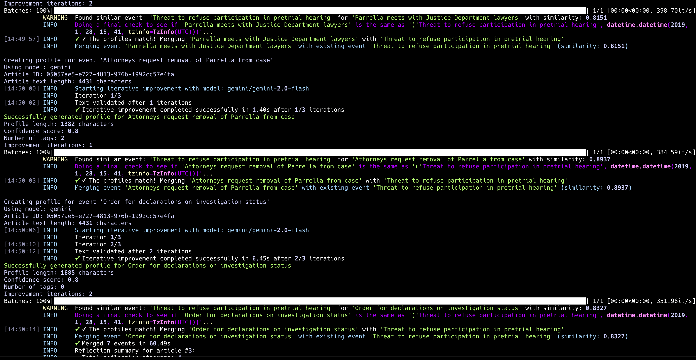
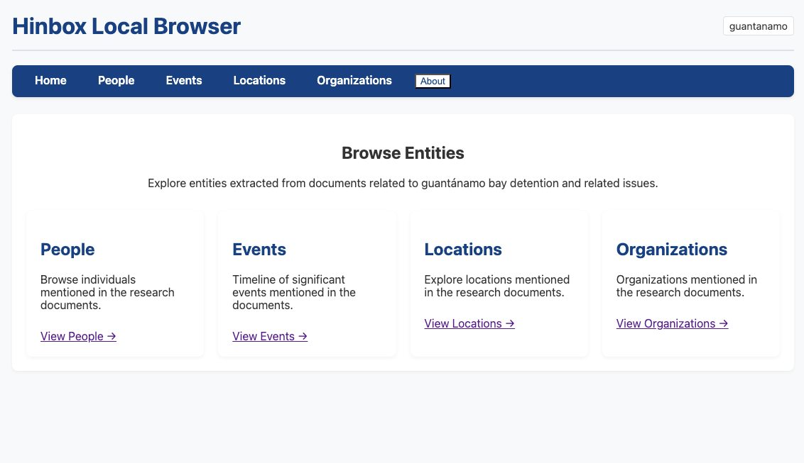
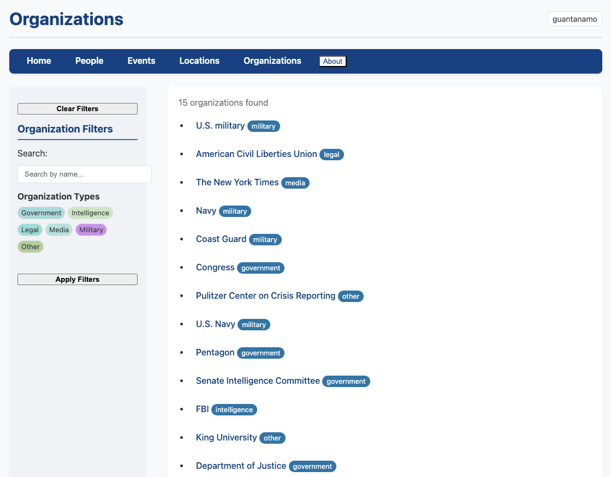
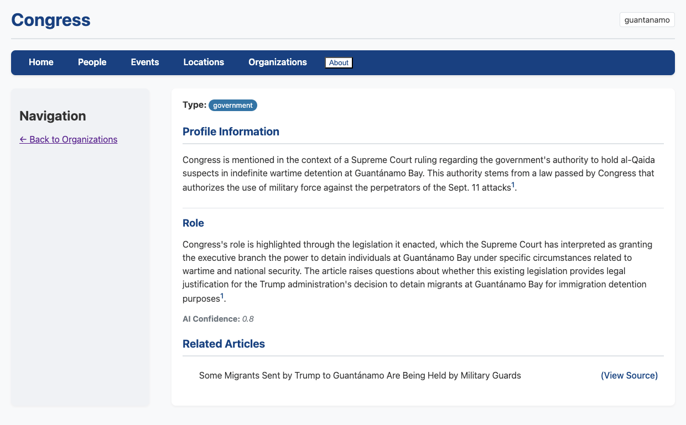

# hinbox

`hinbox` is a flexible, domain-configurable entity extraction system designed
for historians and researchers. It processes historical documents, academic
papers, news articles, and book chapters to extract structured information about
people, organizations, locations, and events. Originally designed for Guantánamo
Bay media coverage analysis, it now supports any historical or research domain
through a simple configuration system.

## 🎯 Key Features

- **Research-Focused**: Designed for historians, academics, and researchers
- **Flexible Sources**: Process historical documents, academic papers, news articles, book chapters
- **Domain-Agnostic**: Configure for any historical period, region, or research topic
- **Multiple AI Models**: Support for cloud models (Gemini, OpenAI, Anthropic,
  OpenRouter) and local models (Ollama) via direct SDK integration  
- **Entity Extraction**: Automatically extract people, organizations, locations, and events
- **Smart Deduplication**: RapidFuzz lexical blocking + embedding similarity with per-entity-type thresholds
- **Merge Dispute Agent**: Second-stage LLM arbitration for ambiguous gray-band entity matches
- **5-Layer Canonical Name Selection**: Deterministic scoring picks the best display name across aliases, penalizing acronyms and generic phrases
- **Profile Versioning**: Track how entity profiles evolve as new sources are processed
- **Profile Grounding**: Citation-backed claim verification checks that profile text is supported by source articles
- **Extraction Quality Controls**: Deterministic QC with automatic retry when severe issues (zero entities, high drop rates) are detected
- **Extraction Caching**: Persistent sidecar cache avoids redundant LLM calls when re-processing unchanged articles
- **Parallel Pipeline**: Concurrent article extraction with LLM rate limiting and batched embedding computation
- **Modular Engine**: `src/engine` coordinates article processing, extraction, merging, and profile versioning so new domains can reuse the same pipeline
- **Privacy Mode**: `--local` flag enforces local-only embeddings and disables all LLM telemetry callbacks
- **Web Interface**: FastHTML-based "Archival Elegance" UI with confidence badges, alias display, tag pills, and profile version navigation
- **Easy Setup**: Simple configuration files, no Python coding required

## 📸 Screenshots

<figure>
  
  <figcaption><em>Real-time processing logs showing entity extraction progress with detailed status updates</em></figcaption>
</figure>

<figure>
  
  <figcaption><em>Main dashboard displaying research domains and extracted entity statistics</em></figcaption>
</figure>

<figure>
  
  <figcaption><em>Organizations listing with search and filtering capabilities for research analysis</em></figcaption>
</figure>

<figure>
  
  <figcaption><em>Detailed organization profile showing extracted information, sources, and version history</em></figcaption>
</figure>

## 🚀 Quick Start

### 1. List Available Domains
```bash
just domains
```

### 2. Create a New Research Domain
```bash
just init palestine_food_history
```

### 3. Configure Your Research Domain
Edit the generated files in `configs/palestine_food_history/`:
- `config.yaml` - Research domain settings and data paths
- `prompts/*.md` - Extraction instructions tailored to your sources
- `categories/*.yaml` - Entity type definitions relevant to your research

### 4. Process Your Sources
```bash
just process-domain palestine_food_history --limit 5
```

### 5. Explore Results
```bash
just frontend
```

## 📦 Installation

### Prerequisites
- Python 3.12+
- `uv` (for dependency management)
- Optional: Ollama (for local model support)
- [`just`](https://just.systems/) (task runner)

### Setup

1. **Clone the repository:**
   ```bash
   git clone https://github.com/strickvl/hinbox.git
   cd hinbox
   ```

2. **Install dependencies:**
   ```bash
   # Cloud embeddings only (works on all platforms including Intel Mac):
   uv sync

   # With local embeddings (requires PyTorch — Linux/Apple Silicon/Windows):
   uv sync --extra local-embeddings
   ```

3. **Set up environment variables:**
   ```bash
   # Create a .env file (auto-loaded by just):
   # The default cloud model is openai/gpt-6-luna:
   echo 'OPENAI_API_KEY=your-openai-api-key' > .env
   # Optional for local processing:
   echo 'OLLAMA_API_URL=http://localhost:11434/v1' >> .env
   ```

4. **Set up local model (optional, requires [Ollama](https://ollama.com)):**
   ```bash
   # Pull the default local model (Qwen 2.5 32B, ~23GB download):
   ollama pull qwen2.5:32b-instruct-q5_K_M

   # Set a realistic context window (Ollama defaults are modest;
   # Qwen 2.5 supports up to 131K tokens but more context = more VRAM).
   # Add to your shell profile or systemd unit for the Ollama server:
   export OLLAMA_CONTEXT_LENGTH=32768
   ```

   You can override the default models without editing code by setting
   environment variables in your `.env` file:
   ```bash
   # Override the local model (default: ollama/qwen2.5:32b-instruct-q5_K_M):
   echo 'HINBOX_OLLAMA_MODEL=ollama/gemma3:27b' >> .env

   # Override the cloud model (default: openai/gpt-6-luna, needs OPENAI_API_KEY).
   # anthropic/... needs ANTHROPIC_API_KEY and `uv sync --extra anthropic`;
   # gemini/... needs GEMINI_API_KEY
   echo 'HINBOX_CLOUD_MODEL=anthropic/claude-haiku-5-5' >> .env

   # Give one task its own model; the rest keep the default above. Tasks:
   # RELEVANCE, EXTRACTION, MATCH, DISPUTE, PROFILE, GROUNDING. The prefix decides where
   # it runs (ollama/ = local). A --local run refuses cloud task models.
   echo 'HINBOX_MATCH_MODEL=ollama/qwen3.6:35b' >> .env
   echo 'HINBOX_PROFILE_MODEL=openai/gpt-6-luna' >> .env

   # Ollama models get reasoning_effort="none" (thinking off) by default;
   # set this to "" to keep a model's own default, or e.g. "high":
   echo 'HINBOX_OLLAMA_REASONING_EFFORT=' >> .env
   # With thinking on, Ollama calls get at least this many output tokens
   # (default 8192) so the model can finish thinking and still answer:
   echo 'HINBOX_OLLAMA_THINKING_MAX_TOKENS=8192' >> .env
   # Ollama silently cuts the start off a prompt longer than the model's
   # context (num_ctx), so Hinbox refuses such prompts. It reads num_ctx from
   # the Ollama server; set this only if the server doesn't report it:
   echo 'HINBOX_OLLAMA_NUM_CTX=32768' >> .env
   ```

5. **Verify installation:**
   ```bash
   just domains
   ```

## 📚 Research Domain Examples

### History of Food in Palestine
```bash
just init palestine_food_history
# Edit configs/palestine_food_history/ to focus on:
# - People: farmers, traders, cookbook authors, anthropologists
# - Organizations: agricultural cooperatives, food companies, research institutions
# - Events: harvests, famines, recipe documentation, cultural exchanges
# - Locations: villages, markets, agricultural regions, refugee camps
```

### Soviet-Afghan War (1980s)
```bash
just init afghanistan_1980s
# Configure for:
# - People: military leaders, diplomats, journalists, mujahideen commanders
# - Organizations: military units, intelligence agencies, NGOs, tribal groups
# - Events: battles, negotiations, refugee movements, arms shipments
# - Locations: provinces, military bases, refugee camps, border crossings
```

### Medieval Trade Networks
```bash
just init medieval_trade
# Set up for:
# - People: merchants, rulers, scholars, travelers
# - Organizations: trading companies, guilds, monasteries, courts
# - Events: trade agreements, diplomatic missions, market fairs
# - Locations: trading posts, cities, trade routes, ports
```

## 🛠 Advanced Usage

### Processing Historical Sources
```bash
# Process with different options
just process --domain afghanistan_1980s --limit 20 --verbose
just process-domain palestine_food_history --limit 10 --relevance-check

# Use local models (requires Ollama) - useful for sensitive historical research
just process --domain medieval_trade --local

# Force reprocessing when you update your configuration
just process --domain afghanistan_1980s --force-reprocess
```

### Web Interface
```bash
just frontend
```
Explore extracted entities at http://localhost:5001

### Traces of every model call
Every run records each pipeline step and each model call (the prompt sent, the reply or tool-call arguments, any reasoning the model returned, token counts, finish reason) as OpenTelemetry spans. One trace per article: `article #3` → `extraction` → `extract.people` → `chat qwen3.6:35b`, and `merge.people` → `match_check` → `chat …`, with each NEW/MERGE/SKIP decision as an event on its merge step.

- **Always**: every span is written as one JSON line to `{output_dir}/traces/run-<timestamp>.jsonl`. That file is ours to keep, whatever viewer we use.
- **To browse them**: run `just phoenix` in a second terminal (Arize Phoenix, one process, stores traces in a SQLite file under `~/.phoenix/`), then run the pipeline with `OTEL_EXPORTER_OTLP_TRACES_ENDPOINT=http://localhost:6006/v1/traces` (e.g. in `.env`) and open http://localhost:6006. Any other OpenTelemetry backend works the same way, e.g. a self-hosted Langfuse at `http://<host>:3000/api/public/otel`.
- **`--local` runs** refuse to start if that endpoint is not on this machine, the LAN or Tailscale, so private articles never leave the network.
- `HINBOX_TRACING=off` turns tracing off.
- **Eval and replay runs are traced too** (`traces/eval-<task>-*.jsonl`, `traces/replay-*.jsonl`): each eval item is its own trace, tagged with its gold label and whether the model got it right, or with its profile-update scores.
- **Training data**: each step notes what its model call was about and how it ended as `hinbox.*` attributes (entity and candidate names, article id, prompt file and hash, verdict, QC flags, edits applied, retry used), and every span records the git commit and `HINBOX_*` settings of the run. `just export-training <traces...> --out <dir>` turns the calls into one `<task>.jsonl` per task in the `{"messages", "tools", "metadata"}` shape TRL, Unsloth and Axolotl read, dropping calls that raised or hit the token limit; filter on `metadata` (e.g. `eval_correct`, `final_attempt`) to pick examples. Keep the output off GitHub: it holds article text.

### Prompts per model
A prompt that suits one model can hurt another: the profile-edit prompt tuned for Qwen3.6 lifted the local models but made GPT-6 Luna skip real new facts. So every prompt file can have variants named `<prompt>.<variant>.md` next to the default `<prompt>.md`. For each prompt, the pipeline uses the first file that exists:

1. a family listed under `prompt_families` in the domain's `config.yaml` whose name parts appear in the model name (`qwen: [qwen]` makes `ollama/qwen3.6:35b` use `relevance.qwen.md`);
2. `<prompt>.local.md` for `ollama/` models, `<prompt>.cloud.md` for the rest;
3. `<prompt>.md`.

This covers relevance, the four extraction prompts and the profile prompts; the merge check builds its prompt in code. Add a variant only when `just eval show --grid` shows it beating the default for that model by 3 or more cases. For example, over the 245 profile-update cases (train, dev and test together), `profile_edit.cloud.md` passes 225 on Luna and 215 on Haiku, against 213 and 191 for the plain `profile_edit.md`: the plain prompt turns passing mentions into 3 to 5 sentences.

### Evaluating Models
The scoreboard grades any model on your hand-labelled answer keys, so you can compare cloud, frontier and local models (or later, optimized prompts) on equal terms.
```bash
# Score a model on the relevance labels or the merge labels
just eval relevance --model openai/gpt-6-luna
just eval merge --model ollama/qwen3.6:35b-a3b --split test

# Show every run so far, or the latest score for each model and prompt file
just eval show
just eval show --grid

# Score a prompt variant the pipeline wouldn't pick for this model
# (relevance.qwen.md, profile_edit.local.md, ...; 'default' = the plain file)
just eval profile-update --model openai/gpt-6-luna --split test --prompt-variant local

# Pick hard look-alike entity pairs to label (writes merge_candidates_v2.jsonl)
just eval-mine

# Grow long profiles by replaying well-covered entities' articles in date order
just eval-replay --list                          # article counts only, no model calls
just eval-replay --model openai/gpt-6-luna --max-articles 40

# Turn those snapshots into profile-update test cases
just eval-cases --model openai/gpt-6-luna

# Run the pipeline's profile update on those cases and score it
just eval profile-update --model openai/gpt-6-luna --split dev
just eval profile-update --model openai/gpt-6-luna --split dev --approach rewrite
```
Gold files live in `{output_dir}/eval/`. Each run writes its per-item predictions to `eval/runs/` and adds one row to `eval/scoreboard.jsonl`. Items are split 60/20/20 into train/dev/test by a stable hash, so anything tuned on `train` is never graded on `test`. Results report balanced accuracy next to the "always give the common answer" baseline, because the label sets are lopsided.

`just eval-replay` prepares data for a profile-update eval. The entity database has no profile built from more than three articles, so it takes eighteen entities the corpus covers heavily (Nashiri, Judge Pohl, Camp Justice, the USS Cole bombing, ...), creates a profile from the first article mostly about each one, then runs the pipeline's own `update_profile` on each later article. It saves the profile after every step to `eval/profile_replay/<model>/<entity>/step_NNN.json`, and resumes where it stopped.

`just eval-cases` turns those snapshots into test cases, each one an existing profile plus an article. There are three kinds: an article that only mentions the entity in passing (a good update keeps everything and changes little), the real next article (a good update adds the new facts with its citation and keeps the rest), and a copy of the next article with one year changed (a good update keeps both years, each with its own source). Cases are split into train/dev/test by entity (6/6/6 for the eighteen replay entities, with every entity type in each split), so a tuned prompt never sees a test entity. Disputed cases come from a word-overlap heuristic and are marked `needs_review` until a person confirms the two sentences make the same claim.

`just eval profile-update` runs the pipeline's `update_profile` on each case and scores the result without a model. A case fails if the profile shrinks by more than 20%, if fewer than 90% of its cited sentences survive (reworded sentences still count as kept), or if it cites an id that is neither an old source nor the new article. Each kind also has its own check: new-fact cases must cite the article, passing-mention cases may add at most two sentences, and disputed cases must keep the old year with its old source and state the new year with the new article. The scoreboard also shows how much old text was kept word for word, because a good update shouldn't rewrite text it had no reason to touch. In the full replay, 40 single updates cut a profile by more than a fifth (one went from 31k characters to 6k), and every one passed the pipeline's own QC.

The pipeline's `update_profile` uses an edit-list updater (`--approach rewrite` scores the old whole-profile rewrite instead). Rather than writing the whole profile again, the model returns a short list of edits: add these sentences after this existing sentence (or under this heading, or at the end), or replace this one sentence with a sharper version. Code applies the edits to the old text, so a sentence the model never mentions stays exactly as it was, and a replaced sentence keeps its citations. The prompt (`profile_edit.cloud.md` for cloud models, `profile_edit.local.md` for local ones) also says to keep both versions, each with its source, when the article contradicts the profile, and to add little or nothing from an article that only mentions the entity in passing. On the dev and test cases it passes 0.89 on Luna against 0.29 for the rewrite, in about 2s per update instead of 21s. Set `HINBOX_PROFILE_UPDATE_APPROACH=rewrite` to run the pipeline with the old rewrite.

Before the edits are applied, code checks each new sentence (`src/engine/edit_guards.py`). It drops a sentence that restates one already in the profile, and a "sources disagree" sentence when no existing sentence on the same thing gives a different year (or a different month or count in the same year). In a 60-article local Qwen run these checks would have removed 83 of 320 repeated sentences and 41 of 312 "sources disagree" sentences; on the labelled test cases they caused no failures. They are strict on purpose (a repeat must use the same words in the same order, a dispute is kept if any old sentence gives another year, count or name), because dropping a real new fact costs more than leaving a repeat in. Most of the "sources disagree" sentences left after that were not disputes but changes over time: the military counted 24 hunger strikers on March 19, 2013 and 28 on March 25, and the second article was written up as "Sources disagree on the number of hunger strikers". So a "sources disagree" sentence is rewritten as a dated timeline entry ("As of March 25, 2013, 28 captives were classified as hunger strikers.") when it is about something that changes (a count of an ongoing state such as hunger strikers, a schedule such as a trial date, who holds a post, a status) and the article was published on another day than the sources of the sentence it disputes (`src/engine/later_updates.py`). The old sentence stays, so both sources are still cited. A disagreement about a one-off past event (a capture, a plea, a bombing date) stays a dispute. In the same 60-article run this rewrites 106 sentences and leaves 85 "sources disagree" sentences (179 before). Two counts for the same named day ("28 on March 25" against "30 on March 25") stay a dispute, and when a sentence quotes several reports, only the one it calls "the article" (or a newer report) is taken as the article's side; on the labelled dev and test cases it changes no result except one Qwen dev case that now passes. It needs the articles' published dates, which the pipeline passes in; without them nothing is rewritten. When a profile is too long for the local model's context window, the fact-list updater below updates it instead.

**Claim labels.** Citing the article is a weak test: a profile that cites it on one vague sentence ("Camp 7 is described as a secretive prison camp") passes the same as one that adds the ruling the article was about. `eval/claim_labels.jsonl` holds, for one entity and one article, the facts a good profile should now state (each with a short quote, who said or alleged it, and whether it is core) and readings it must not add (the wrong person doing it, a claim turned around). Each fact carries a few word groups, and a sentence backed by the article (citing it, or followed in its paragraph by a citation of it, since profiles cite once per paragraph) that has a word from every group counts as stating it; attribution goes into the groups, so an allegation stated as plain fact doesn't count. A new-fact case with a label passes only when every core fact is stated, no wrong reading is added, and no "sources disagree" sentence is added unless the article itself reports a conflict. Rows start as `draft` and only `reviewed` rows are scored unless you pass `--claim-labels draft`. `just eval profile-update --rescore <run file> --split test` scores a saved run again with today's checks, without model calls, and prints which cases changed and why.

`--approach facts` scores a prototype for very long profiles (`src/engine/fact_list.py`), which no model call ever sees whole. The model lists the article's claims about the entity, each with an exact quote that code checks against the article. Code then finds the few existing sentences most like each claim, and the model says whether the claim is the same, new, or in conflict. A repeated claim is only counted, not cited again, unless it comes from a different kind of source (a court record where the profile rested on a newspaper). A conflict is written by code right after the old sentence, so both versions stay. New facts are placed one section at a time. Set `HINBOX_PROFILE_UPDATE_APPROACH=facts` to use it in `just process`; each profile then keeps its fact rows (who said what, which articles only repeated a fact) under `fact_rows_json` for the next update. A later state of the same thing (a transfer, a decision after "still deciding") is kept as a timeline, not called a conflict.

The claims step only lists what an article says about the entity, so a date in a background sentence ("17 sailors died in the bombing of the USS Cole on Oct. 12, 1999", in an article about a hearing) never gets compared. A separate date check (`src/engine/date_disputes.py`) covers that: code pairs each dated article sentence with the profile's cited sentences that give a different year or month and share enough words, and one model call says whether each pair is the same past event with two dates, two different events, or a plan or count that changed over time. Only the first is written, right after the old sentence and cited to the article. Most articles give no pairs, so most updates make no extra call. It is off by default (`HINBOX_FACT_DATE_CHECK=on` turns it on): on the eval it caught real errors already in profiles (one said Omar Khadr pleaded guilty in 2011; it was October 2010), but it also wrote one to three wrong "Another report differs" sentences per 160 cases, where the updater without it writes none.

**DSPy experiments** live in [`experiments/dspy_opt/`](experiments/dspy_opt/README.md), in their own environment, so DSPy never enters Hinbox's main dependencies, and LiteLLM is never installed. `just dspy-merge --model <model> --optimizer mipro` optimises the merge check for one model and puts the result on the same scoreboard. `just dspy-profile --model <model> --reflection-model openai/gpt-6-luna` runs GEPA on the edit-list profile updater.

### Data Management
```bash
# Check processing status
just check

# Reset processing status
just reset

# View available domains
just domains
```

## 📂 Project Structure

```
configs/
├── guantanamo/        # Example domain shipped with the project
├── template/          # Starter files copied by `just init`
└── README.md          # Domain configuration walkthrough

src/
├── process_and_extract.py  # CLI entry point — parallel producer/consumer pipeline
├── engine/
│   ├── article_processor.py   # Relevance → extraction → QC retry orchestration
│   ├── extractors.py          # Unified cloud/local entity extraction
│   ├── mergers.py             # Lexical blocking → embedding similarity → match check → dispute
│   ├── merge_candidates.py    # Lexical blocking + embedding similarity search
│   ├── merge_evidence.py      # Deterministic evidence text + batch embedding
│   ├── match_checker.py       # LLM-based match verification
│   ├── merge_dispute_agent.py # Second-stage arbitration for gray-band matches
│   ├── profiles.py            # VersionedProfile history management
│   └── relevance.py           # Domain-specific relevance filtering
├── frontend/               # FastHTML "Archival Elegance" UI
│   ├── routes/             # Modular route handlers (home, people, orgs, locations, events)
│   ├── components.py       # Reusable UI building blocks (badges, version selectors, tags)
│   ├── data_access.py      # Centralised Parquet data loading
│   └── static/styles.css   # CSS variables, fonts, layout
├── utils/
│   ├── embeddings/         # EmbeddingManager, cloud/local providers, similarity helpers
│   ├── cache_utils.py      # Thread-safe LRU cache and stable hashing
│   ├── extraction_cache.py # Persistent sidecar cache for extraction results
│   ├── name_variants.py    # Deterministic name normalisation, acronym detection, canonical scoring
│   ├── processing_status.py # Sidecar JSON tracker (replaces in-Parquet status)
│   ├── outcomes.py         # PhaseOutcome structured result objects
│   ├── grounding.py        # Profile grounding verification
│   └── quality_controls.py # Extraction QC and profile QC
├── config_loader.py        # Domain config loader (incl. per-type thresholds, lexical blocking)
├── dynamic_models.py       # Domain-driven Pydantic model factories
├── constants.py            # Model defaults, embedding settings, thresholds, privacy controls
├── logging_config.py       # Rich-based structured logging with colour-coded decision lines
└── exceptions.py           # Custom exception types used across the pipeline

tests/
├── embeddings/                         # Embedding manager, cloud provider, config integration
├── test_canonical_name.py              # 5-layer canonical name scoring and rekey-on-merge
├── test_cli_privacy_mode.py            # --local flag enforces local embeddings
├── test_domain_paths.py                # Domain-specific path resolution and batch writes
├── test_entity_merger_merge_smoke.py   # Embedding-based merge smoke tests
├── test_entity_merger_similarity.py    # Similarity scoring, lexical blocking, fingerprints
├── test_extraction_cache.py            # Sidecar cache key determinism and roundtrip
├── test_extraction_retry.py            # QC-triggered retry logic and repair hints
├── test_llm_multiple_tool_calls.py     # Instructor multi-tool-call recovery
├── test_merge_dispute_agent_routing.py # Gray-band routing and dispute decisions
├── test_name_variants.py               # Name normalisation, acronyms, equivalence groups
├── test_profile_grounding.py           # Citation extraction and grounding verification
├── test_profile_versioning.py          # Versioned profile regression tests
└── test_frontend_versioning.py         # UI behaviour for profile history

data/
├── guantanamo/        # Default domain data directory (created locally)
└── {domain}/          # Additional domains maintain their own raw/entity data
```

## 🔧 Configuration

### Domain Configuration
Each domain has its own `configs/{domain}/` directory with:

**config.yaml** - Main settings:
```yaml
domain: "palestine_food_history"
description: "Historical analysis of Palestinian food culture and agriculture"
data_sources:
  default_path: "data/palestine_food_history/raw_sources/historical_sources.parquet"
output:
  directory: "data/palestine_food_history/entities"
```

**categories/*.yaml** - Entity type definitions:
```yaml
person_types:
  player:
    description: "Professional football players"
    examples: ["Lionel Messi", "Cristiano Ronaldo"]
```

**prompts/*.md** - Extraction instructions (plain English!):
```markdown
You are an expert at extracting people from historical documents about Palestinian food culture.
Focus on farmers, traders, cookbook authors, researchers, and community leaders...
```

### Data Format
Historical sources should be in Parquet format with columns:
- `title`: Document/article title
- `content`: Full text content  
- `url`: Source URL (if applicable)
- `published_date`: Publication/creation date
- `source_type`: "book_chapter", "journal_article", "news_article", "archival_document", etc.

## 🏗 Architecture

### Processing Pipeline
1. **Configuration Loading**: Read domain-specific settings
2. **Source Loading**: Process historical documents in Parquet format
3. **Relevance Filtering**: Domain-specific content filtering for research focus
4. **Parallel Extraction**: Concurrent article + entity-type extraction with LLM rate limiting (`ThreadPoolExecutor` workers, bounded semaphore for API calls)
5. **Extraction Caching**: Persistent sidecar cache keyed on content hash, model, prompt, and schema — skips redundant LLM calls on re-runs
6. **Quality Controls**: Deterministic QC validates extraction output (required fields, name normalisation, within-article dedup) with automatic retry on severe flags
7. **Smart Deduplication**: Lexical blocking pre-filter → batched embedding similarity → evidence-first merge cost structure (cheap checks before expensive LLM calls)
8. **Merge Dispute Resolution**: Gray-band matches (similarity near threshold with low confidence) get a second-stage LLM arbitration via `MergeDisputeAgent`
9. **Canonical Name Selection**: 5-layer scoring picks the best display name when entities merge, penalizing acronyms and generic phrases
10. **Profile Generation**: Create comprehensive entity profiles with citation-backed claims and automatic versioning
11. **Profile Grounding**: Post-processing verification that profile claims are supported by cited source articles
12. **Persistence**: Batched Parquet writes per entity type (avoiding write amplification), sidecar JSON for processing status

### Engine Modules
- `ArticleProcessor` orchestrates relevance checks, extraction dispatch (with QC retry), and per-article metadata aggregation (`src/engine/article_processor.py`)
- `EntityExtractor` unifies cloud and local model calls using domain-specific Pydantic schemas (`src/engine/extractors.py`)
- `EntityMerger` pre-filters with RapidFuzz lexical blocking, compares batched embeddings, calls match-checkers, routes gray-band cases to the dispute agent, and updates persisted Parquet rows (`src/engine/mergers.py`)
- `MergeDisputeAgent` provides second-stage structured LLM analysis for ambiguous merge/skip decisions (`src/engine/merge_dispute_agent.py`)
- `VersionedProfile` and helper functions maintain profile history for each entity (`src/engine/profiles.py`)

### Key Features
- **Domain-Agnostic**: Easy to configure for any topic
- **Multiple AI Models**: Cloud (Gemini) and local (Ollama) support
- **Privacy Mode**: `--local` flag forces local embeddings and disables all LLM telemetry
- **Smart Processing**: Automatic relevance filtering, caching, and multi-layer deduplication
- **Profile Versioning**: Track entity profile changes over time with full version history
- **Profile Grounding**: Citation-backed claim verification for generated profiles
- **Modern Interface**: FastHTML "Archival Elegance" theme with confidence badges, aliases, tag pills, and version navigation
- **Robust Pipeline**: Structured `PhaseOutcome` error handling, quality controls, extraction retry, and progress tracking
- **Structured Logging**: Colour-coded decision lines (`NEW`, `MERGE`, `SKIP`, `DISPUTE`, `DEFER`) for pipeline transparency

## Development

### Testing
```bash
# Run all tests
just test

# Run specific test files
just test -k test_profile_versioning
just test tests/test_entity_merger_similarity.py
```

CI runs lint and tests automatically on every PR (`.github/workflows/test.yml`). The test suite covers embedding similarity, lexical blocking, per-type threshold resolution, entity merger behavior, merge dispute agent routing, extraction caching, extraction retry logic, canonical name selection, name variant detection, profile grounding, profile versioning, privacy mode enforcement, and frontend components — all without requiring API keys or GPU.

### Code Quality
```bash
# Format code
just format

# Lint code
just lint

# Both together
just check-code

# Fail if any tracked .py file is over 1000 lines
just check-file-length

# Run exactly what CI runs (recommended before pushing)
just ci
```

## 🤝 Contributing

Contributions welcome! Areas of interest:
- New domain templates and examples
- Additional language model integrations
- Enhanced web interface features
- Performance optimizations

## 📄 License

MIT License - see [LICENSE](LICENSE) file for details.

## 🙋 Support

For questions about:
- **Configuration**: See `configs/README.md`
- **Setup**: Check installation steps above
- **Usage**: Try `just` or `just --list`
- **Issues**: Open a GitHub issue

---

**Built for**: Historians, researchers, and academics working with large document collections

**Built with**: Python, Pydantic, FastHTML, Instructor, OpenAI SDK, RapidFuzz, Jina Embeddings, Rich
