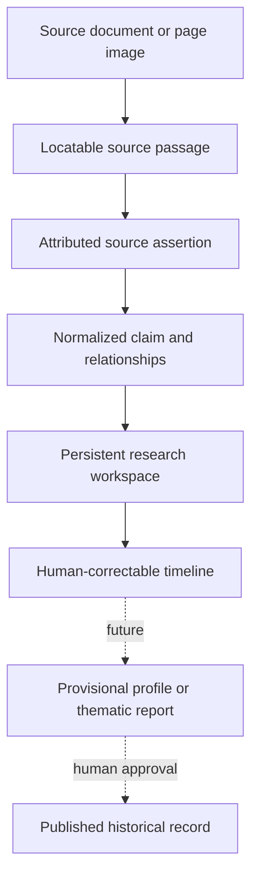
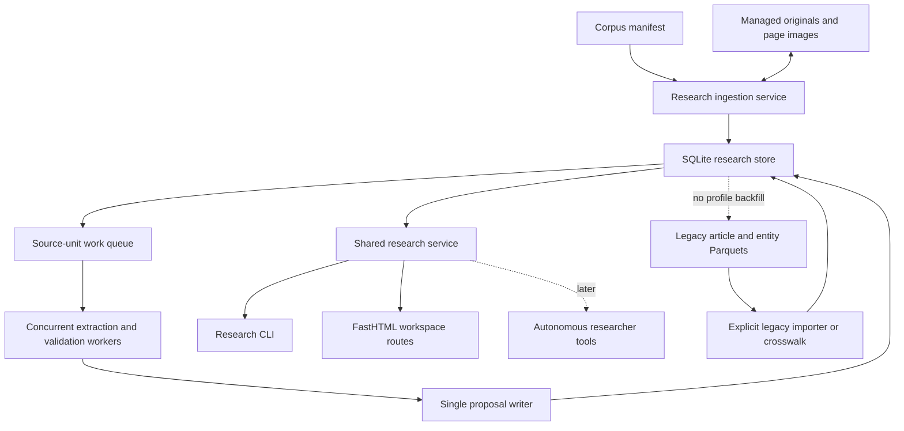
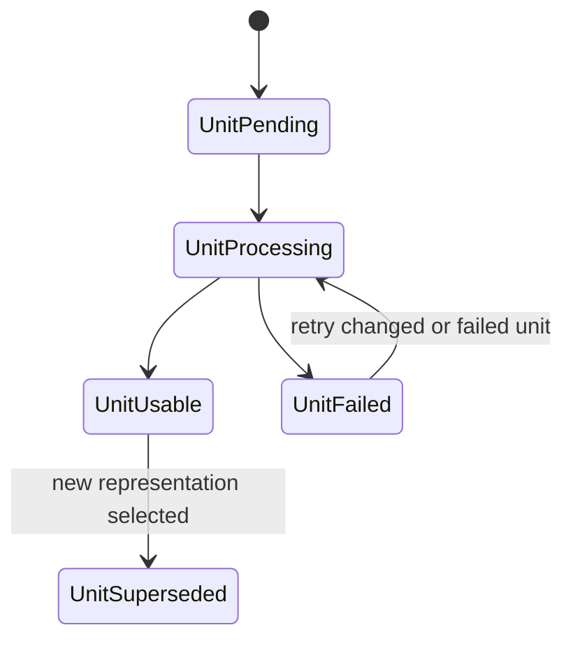
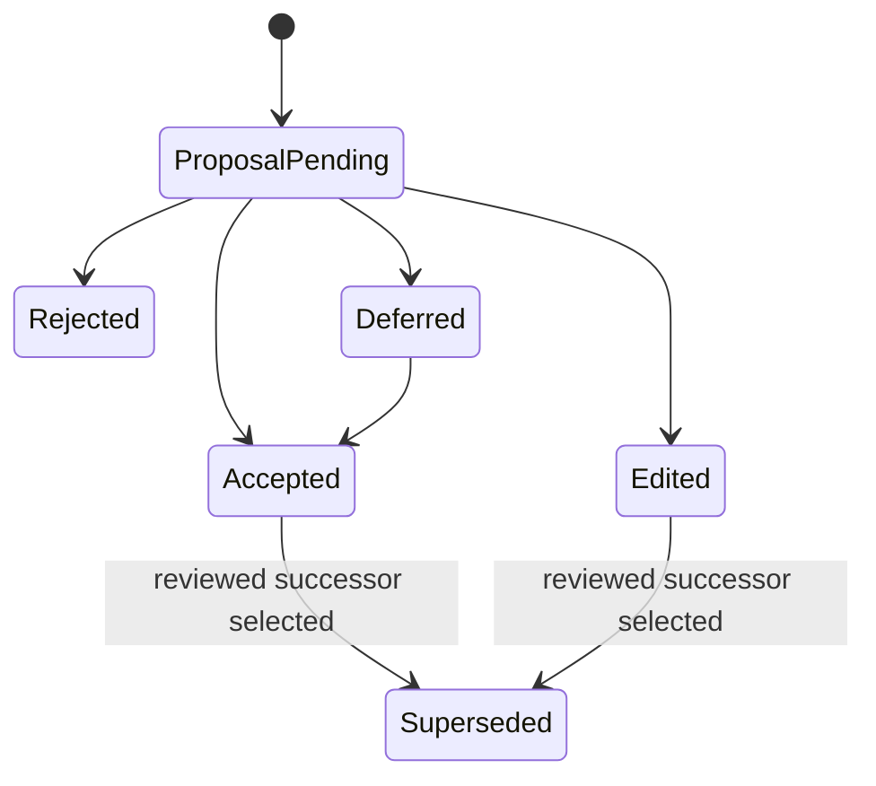
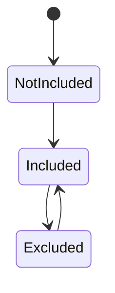

# Evidence-First Historical Research Foundation - Plan

## Goal Capsule

- **Objective:** Make Hinbox preserve and organize source-grounded historical evidence before it generates narrative profiles.
- **Project identity:** Hinbox is a scholarly research and passion project, not a commercial product; its records and publications should be historically and methodologically defensible.
- **Scholarly authority:** The historian controls interpretation and publication; automated systems create provisional research records and recommendations.
- **First release:** A persistent, human-correctable evidence workspace and timeline built from a substantial but explicitly bounded mixed-source corpus concerning Zaeef.
- **Release claim:** This release tests evidence fidelity, traceability, correction durability, and research usefulness; contamination reduction in later narrative synthesis remains explicitly untested until synthesis exists.
- **Launch blockers:** None. U9 calibrates corpus formats and the Release 0 threshold before adapter work; U7 may add bulk review only if measured workload requires it.

---

## Product Contract

`Product Contract` is the plan framework's standard heading. In this document it defines the scholarly behaviour and boundaries of a research project; it does not describe Hinbox as a commercial product.

### Summary

Hinbox will ingest mixed-format historical sources into traceable passages, attributed claims, relationships, and research workspaces before generating narrative profiles.
The first release will organize a bounded Zaeef corpus into an evidence-backed timeline without attempting a finished biography.

### Problem Frame

Hinbox currently creates an entity profile from an article and repeatedly rewrites that prose as new articles arrive.
Although profile versions and citations preserve some history, the prose remains the main input to each subsequent update.
An early, biased, incomplete, or mistaken account can therefore shape later summaries, while facts may be dropped or qualifications flattened during repeated rewriting.

Historical research proceeds differently.
A historian first accumulates source passages, compares accounts, maps people and events, notices dependencies and disagreements, and withholds synthesis until the available evidence can support a provisional interpretation.
The same evidence may later need to be reread through a different personal, chronological, geographic, or thematic lens.

Hinbox needs to preserve that pre-synthesis research state.
It must distinguish what a source says from what Hinbox extracts, what a researcher infers, and what is eventually approved for publication.

### Key Decisions

- **The ledger stores source assertions, not timeless facts.** A record means that a particular source makes a particular claim in a locatable passage; its presence does not certify that the claim is true.
- **Source passages precede normalized claims.** Hinbox retains the original evidence and locator so later researchers and better models can reinterpret it without trusting an earlier extraction.
- **Evidence, research, and publication have different authority.** Source material is durable, interpretations are revisable, and publication initially requires human approval.
- **Themes are research lenses, not peer entity types.** People, organizations, places, events, and sources anchor evidence; thematic workspaces organize those records around a question.
- **The first release is corpus-defined.** It reflects the temporal coverage, clusters, and gaps present in the ingested Zaeef sources instead of forcing the corpus into one predetermined episode.
- **The timeline is the first useful research view.** It organizes claims across sources while leaving uncertainty, conflicts, and missing periods visible.
- **Derived work never becomes independent corroboration.** A later agent may use an earlier report for orientation, but evidential support must resolve back to original source passages.
- **Exact quotation is deterministic.** Models may identify relevant spans, but displayed quotations must be retrieved from stored text or page regions rather than reproduced from model output.

The authority chain is:



### Actors

- A1. **Historian or researcher:** supplies sources, corrects records, curates research workspaces, assesses interpretations, and controls publication.
- A2. **Ingestion and extraction agent:** processes source material and proposes passages, assertions, entities, dates, places, and relationships.
- A3. **Validation agent:** checks locators, grounding, contradictions, source dependencies, and unsupported inferences without silently resolving them.
- A4. **Future synthesis agent:** creates narrative profiles, interpretive timelines, and thematic reports from selected original evidence while preserving an evidence manifest.

### Requirements

**Source and passage foundation**

- R1. Hinbox must ingest an explicitly identified corpus whose contents and omissions remain inspectable.
- R2. Hinbox must support born-digital text and source material represented as scanned or photographed pages.
- R3. Hinbox must preserve enough bibliographic and archival information to identify and cite the source, including source type, authorship, publication or creation date, edition or version, language, translation context, and stable identifiers or access details when available.
- R4. Hinbox must preserve page, chapter, section, transcript-line, archival, or equivalent locators appropriate to each source.
- R5. Hinbox must keep original page images, raw OCR, corrected transcription, translations, and normalized interpretation distinguishable, with the creator or process, version, review state, and relationship between forms recorded when known.
- R6. Hinbox must preserve a locatable passage before attaching a normalized claim to it.
- R7. Hinbox must retrieve displayed quotations deterministically from a named stored textual representation, verify their correspondence to the locator, and label whether the wording is original-language text, a published or researcher translation, generated translation, transcription, or paraphrase.
- R8. Hinbox must treat agent-selected passage boundaries as provisional, retain relevant surrounding context without duplicating the whole source, and let the historian inspect and expand that context.
- R35. Hinbox must preserve, when known, source-criticism context such as genre, intended audience, purpose, institutional setting, circumstances of creation, and the creator's position without reducing these observations to one universal credibility score.
- R36. Hinbox must expose processing, partially usable, failed, corrected, and superseded ingestion states at the affected source or page while keeping successfully processed material inspectable.

**Claims, entities, and provenance**

- R9. Hinbox must represent each source assertion as an attributed record rather than as an unqualified system fact.
- R10. Hinbox must link every normalized claim to at least one source passage and identify the extraction or human action that produced it.
- R11. Hinbox must distinguish source assertions, normalized claims, historian assessments, model-generated hypotheses, and publication prose.
- R12. Hinbox must use people, organizations, places, events, and sources as the initial concrete anchors for historical evidence.
- R13. Hinbox must represent source-grounded relationships between anchors without turning an extracted relationship into an unqualified graph fact.
- R14. Hinbox must preserve the recorded rationale, evidence, author, uncertainty, and revision history for judgments that assertions agree, contradict, qualify, correct, repeat, or derive from the same underlying account.
- R15. Hinbox must keep identity judgments separate from display names so distinct people with the same name can remain representable.
- R16. Hinbox must distinguish when an event allegedly occurred, when a source described it, and when Hinbox recorded or revised the claim.
- R37. Hinbox must preserve material qualifiers and the recorded rationale when assertions are normalized together or treated as compatible, qualifying, or contradictory.
- R38. Hinbox must allow claim-relative assessments of how a source could know an assertion, including observation, participation, attributed report, hearsay, documentary access, retrospective recollection, later synthesis, and unknown basis; these assessments remain attributed and revisable.

**Research workspace and timeline**

- R17. Hinbox must provide a persistent research workspace whose evidence selection, exclusions, notes, corrections, questions, and interpretations survive across sessions and reprocessing.
- R18. Hinbox must organize the first Zaeef workspace as a timeline derived from the corpus rather than from a predetermined biographical outline.
- R19. Hinbox must allow the historian to inspect timeline entries by period, place, person, organization, event, source, source type, and available themes.
- R20. Hinbox must allow every timeline assertion to return to the exact source passage or page region that supports it.
- R21. Hinbox must preserve approximate, conflicting, and unknown dates instead of coercing them into false precision.
- R22. Hinbox must display source disagreements, repeated accounts, unresolved identity questions, and corpus gaps without automatically reconciling them or presenting lack of ingested evidence as historical absence.
- R23. Hinbox must distinguish source-record count from assessed underlying-account count while keeping dependency judgments evidenced, attributed, uncertain when necessary, and revisable.
- R24. Hinbox must treat proposal judgment and workspace inclusion as separate reversible decisions: a historian can accept, edit, reject, or defer a proposal, and can independently include or exclude the resulting research record from the current workspace, with a reason recorded when provided.
- R25. Hinbox must preserve human corrections and prevent later automated processing from silently reverting them.
- R39. Consequential corrections must present an inspectable impact set of affected passages, assertions, claims, relationships, and timeline entries before dependent accepted records are replaced.
- R40. The timeline and review workflow must remain operable without color or spatial layout alone, including keyboard-operable actions, labelled status and disagreement, associated text for page images, and an ordered list or table representation.

**Authority and reuse**

- R26. Automatically produced assertions, relationships, summaries, and timeline entries must remain provisional until they meet their artifact-specific review threshold; consequential or contested allegations must retain explicit attribution and status wherever displayed.
- R27. The first release must not publish interpretive artifacts. Any later promotion to a published historical record requires explicit human editorial approval and does not certify that every included claim is true.

**Future synthesis compatibility**

- R28. Any generated report or profile must carry an evidence manifest that identifies the passages, claims, exclusions, conflicts, explicit inferences, earlier reports, agent run, and review state behind it.
- R29. When later research uses an earlier Hinbox report, evidential claims must resolve to the earlier report's original passages rather than treating the report as independent corroboration.
- R43. Future publication work must preserve publication versions while making the currently approved version and its corpus limits unambiguous.
- R41. Future interpretive artifacts must carry a corpus statement naming included material, review cutoff, exclusions, known inaccessible or unprocessed material, and the limits these place on conclusions.
- R42. Before interpretive material supports publication, its reasoning record must identify supporting and contrary passages, assumptions, uncertainty, and competing interpretations.

**Research-record versioning**

- R30. Hinbox must preserve superseded research-record states and make the selected current reviewed version unambiguous.

**Evaluation and future learning**

- R31. Hinbox must record a stable task or episode ID, the exact workspace revision and candidate context shown to the model, proposed actions, tool calls and results, validation outcomes, before-and-after accepted state, model, prompt, task and code versions, and timestamps for automated research actions.
- R32. Hinbox must record the historian's decision, reason, and edited result separately from the original proposal, distinguish correctness from relevance and workspace inclusion, and record whether sources and feedback are eligible for later evaluation or training; model training itself remains deferred.
- R33. The evidence foundation must remain usable by later models without requiring source re-ingestion or trusting earlier model summaries.
- R34. The first release must be evaluable independently of profile-writing quality.

### Key Flows

- F1. **Ingest and preserve a source**
  - **Trigger:** A1 adds a text file, digital document, scan, or photographed source to the bounded corpus.
  - **Actors:** A1, A2, A3.
  - **Steps:** Hinbox records source identity, preserves the original representation, derives inspectable text where needed, and proposes locatable passages.
  - **Outcome:** The source can be searched and cited without losing its original form or provenance.
  - **Covered by:** R1-R8, R31.

- F2. **Construct the evidence timeline**
  - **Trigger:** Sources in the Zaeef workspace contain relevant passages and temporal claims.
  - **Actors:** A1, A2, A3.
  - **Steps:** Hinbox proposes assertions, entities, relationships, and dates; groups related accounts; preserves uncertainty; and exposes conflicts and dependencies for review.
  - **Outcome:** A1 can navigate a corpus-derived chronology and return from every assertion to its evidence.
  - **Covered by:** R9-R24.

- F3. **Correct and reprocess research records**
  - **Trigger:** A1 corrects OCR, a locator, an entity link, a date, a claim, or an interpretation, or a later model reruns a research task.
  - **Actors:** A1, A2, A3.
  - **Steps:** Hinbox records the correction, preserves the superseded state, applies the correction to affected views, and protects the accepted judgment from silent regression.
  - **Outcome:** Research improves over time without erasing provenance or repeating resolved mistakes.
  - **Covered by:** R5, R17, R24-R25, R30-R33.

- F4. **Reuse prior research safely (deferred synthesis flow)**
  - **Trigger:** A future workspace or synthesis consults an earlier Hinbox timeline, profile, or report.
  - **Actors:** A1, A3, A4.
  - **Steps:** Hinbox uses the earlier artifact for orientation, retrieves the underlying passages, searches for omitted or contrary evidence, and marks reused inferences as interpretations.
  - **Outcome:** Research compounds without turning summaries into artificial evidence.
  - **Covered by:** R11, R14, R28-R29, R33, R41-R43.

### Acceptance Examples

- AE1. **Covers R2, R4-R7.** Given a photographed memoir page, when an agent identifies a relevant paragraph, then Hinbox shows the selected OCR text beside the source image region and records the page locator without asking the model to reproduce the quotation.
- AE2. **Covers R16, R18, R21-R22.** Given two sources that place the same event in different months, when the timeline is assembled, then both attributed dates remain visible and the entry is marked disputed rather than assigned the newer date.
- AE3. **Covers R14, R23.** Given five articles that repeat one wire report, when corroboration is summarized, then Hinbox shows five source records but does not present them as five independent accounts.
- AE4. **Covers R17-R20.** Given a workspace whose sources cluster around detention and release but leave earlier years sparse, when A1 browses the timeline, then the dense clusters and gaps remain visible instead of being filled with unsupported biography.
- AE5. **Covers R24-R25, R30.** Given a historian correction to an OCR span or entity link, when extraction is rerun with a later model, then Hinbox preserves the correction, records the new proposal, and does not silently restore the rejected value.
- AE6. **Deferred synthesis example; covers R28-R29.** Given a later thematic report that consults an approved Zaeef timeline, when it cites a historical claim, then the evidence resolves to original source passages and the timeline is recorded only as an earlier interpretation consulted.
- AE7. **Covers R36.** Given a photographed source with two readable pages and one failed OCR page, when ingestion completes, then the readable pages remain searchable while the failed page stays visibly attached to the source with a retry or correction state.
- AE8. **Covers R24.** Given an accurate assertion that is irrelevant to the current workspace, when A1 accepts its extraction but excludes it from this timeline, then both decisions remain visible and reversible.
- AE9. **Covers R26.** Given a source alleging serious misconduct, when the assertion appears in a review queue or timeline, then attribution and allegation status remain visible and it is not rendered as an established event.
- AE10. **Covers R22.** Given a sparse period caused by unprocessed material, when A1 inspects the timeline, then Hinbox labels the processing gap rather than implying that nothing happened.

### Success Criteria

- Every displayed quotation and timeline assertion returns to an inspectable source locator or page region.
- The workspace makes uncertain dates, contradictory accounts, dependent sources, and corpus gaps visible without requiring the historian to reconstruct them from prose.
- A historian can correct OCR, evidence selection, entities, dates, claims, and relationships, and those corrections survive reprocessing.
- The timeline is meaningfully more useful for investigating the bounded corpus than searching the original source folder alone.
- A historian can use the workspace to reconstruct a disputed episode, inspect all evidence within a date range, trace repeated reporting to an assessed underlying account, and correct an OCR-backed assertion without rebuilding provenance by hand.
- The usefulness evaluation records task completion, major errors, and historian review time so infrastructure completeness is not mistaken for research value.
- Failures in evidence capture can be evaluated separately from failures in later narrative synthesis.
- Human review decisions produce reusable evaluation records rather than disappearing into edited prose.
- This release validates evidence fidelity, traceability, correction durability, and research usefulness; whether evidence-first synthesis reduces repeated-summary contamination remains a separate future evaluation.

### Scope Boundaries

**Deferred for later**

- A finished Zaeef biography or Britannica-style detainee profile.
- Thematic research reports, comparative commander studies, and other long-form syntheses.
- Autonomous promotion of interpretive artifacts to published status.
- Reinforcement learning, distillation, or deployment of specialist research models.
- Broad deployment across every detainee or the complete Guantanamo corpus.
- A publication-facing interface for general readers.
- Persistent thematic interpretations, research questions, and publication-readiness workflows beyond what the first evidence-timeline evaluation consumes.

**Outside the project's scholarly identity**

- Treating profile prose as the sole source of truth.
- Treating article count as corroboration count.
- Assigning one universal credibility score to a source for every possible claim.
- Letting derived reports silently become independent evidence for later reports.
- Replacing source criticism with model confidence.

### Dependencies and Assumptions

- A varied Zaeef corpus can be assembled for the first evaluation, including enough sources to expose chronology, disagreement, source dependency, and gaps.
- Rights and access conditions permit Hinbox to process and retain the selected source material for this research use.
- Source preparation quality will vary, particularly for photographs, scans, OCR, editions, and translations.
- Open models are expected to improve, but the evidence foundation must remain valuable even when automated interpretation is weak.
- The current people, organizations, places, and events remain useful anchors while sources, passages, claims, and relationships provide the missing research structure.

### Implementation-Stage Calibration

- U9 must define the frozen corpus format matrix, what “substantial” means for the later mixed-source evaluation, and the material-advantage threshold used at U10 before U2 adapter scope is finalized.
- U9 must set an acceptable review-minutes or proposals-per-source ceiling for Release 0. U7 defaults to filtered single-item review plus compound accept-and-include, but must include a bounded bulk workflow before U8 if U10 exceeds that ceiling.

### Sources and Research

- `design/2026-07-04-entity-fact-ledger-and-dedup-register.md` contains the earlier ledger, stable-identity, and rebuild proposal that this contract reshapes around pre-synthesis historical research.
- `src/engine/profiles.py` shows that profile updates currently combine the existing profile with one new article and produce a replacement profile version.
- `configs/guantanamo/prompts/profile_update.md` currently instructs updates to prefer newer details when information conflicts.
- `src/utils/quality_controls.py` contains the current post-generation citation-grounding checks.
- [King's College London Factoid Prosopography](https://www.kcl.ac.uk/factoid-prosopography/about) provides a close historical precedent for treating a locatable source assertion as the basic research unit.
- [OpenSanctions statement model](https://www.opensanctions.org/docs/statements/) demonstrates per-value lineage, temporal range, and rebuildable entity exports.
- [W3C PROV-O](https://www.w3.org/TR/prov-o/) distinguishes entities, activities, and agents for provenance descriptions.
- [Nanopublication Guidelines](https://nanopub.net/guidelines/working_draft/) distinguish an assertion, the provenance of the assertion, and publication information.
- [CIDOC CRMinf](https://cidoc-crm.org/sites/default/files/CRMinf%20ver%2010.1.pdf) models argumentation, inference, beliefs, and provenance as distinct historical-information structures.
- [AHA Statement on Standards of Professional Conduct](https://www.historians.org/resource/statement-on-standards-of-professional-conduct/) grounds the requirements to document findings, preserve source evidence, and make research data inspectable.
- [W3C Web Annotation Data Model](https://www.w3.org/TR/annotation-model/) informs resilient text and media selectors while warning that position-only selectors are brittle when a representation changes.
- [IIIF Presentation API 3.0](https://iiif.io/api/presentation/3.0/) and [IIIF Image API 3.0](https://iiif.io/api/image/3.0/) inform the source, page, annotation, and image-region vocabulary without requiring an IIIF server.
- [Library of Congress ALTO](https://www.loc.gov/standards/alto/techcenter/elementSet/index.html) provides a precedent for linking OCR text and layout coordinates to source page images.
- [Library of Congress MODS](https://www.loc.gov/standards/mods/) and [METS overview](https://www.loc.gov/standards/mets/METSOverview.v2.html) inform flexible bibliographic description, representation inventories, structural maps, and digital provenance without requiring those XML schemas internally.
- [SQLite transactions](https://www.sqlite.org/lang_transaction.html), [foreign keys](https://www.sqlite.org/foreignkeys.html), [FTS5](https://www.sqlite.org/fts5.html), and [WAL](https://sqlite.org/wal.html) support the single-writer relational-store decision and its stated concurrency limits.

---

## Planning Contract

### Product Contract Preservation

The requirements review changed R3, R5, R7-R9, R14, R22-R27, R30-R32 to remove ambiguity, added R35-R42 for source criticism, partial ingestion, normalization rationale, claim-relative source position, correction impact, accessibility, corpus limits, and interpretive reasoning, and split future publication versioning into R43.
It also marked R28-R29, R41-R43, and F4 as future synthesis compatibility while keeping R30 as the active research-record versioning requirement.
These are clarifications and scholarly safeguards within the agreed evidence-first scope; the first-release outcome remains the bounded Zaeef evidence workspace and timeline.

### Key Technical Decisions

- KTD1. **Add a research store beside the legacy pipeline.** A new SQLite database is authoritative for sources, representations, passages, proposals, reviewed research records, workspaces, and revision history. The existing article Parquet, entity Parquets, profile versions, and profile routes remain a compatibility path during evaluation; they are neither migrated wholesale nor treated as evidence. After U8, the project must choose whether profile processing is frozen or deprecated, retained read-only, or kept as a separately maintained derived view rather than assume two writable systems forever.
- KTD2. **Keep source bytes outside SQLite and version every representation.** Originals and textual or image representations live in a managed domain research directory under checksum-addressed blob paths. SQLite records separate bibliographic source identities, corpus-scoped import keys, corpus membership, rights or access notes, blob checksums, and immutable representation versions. Checksums deduplicate bytes, never bibliographic sources.
- KTD3. **Use explicit, portable locators without implementing a standards server.** Text passages bind to an immutable representation version with offsets plus quote context; image-backed passages may also carry page and `xywh` region coordinates. The shape borrows from W3C Web Annotation, IIIF, and ALTO, but the first release does not implement JSON-LD, IIIF services, METS, MODS, or a universal archival ontology.
- KTD4. **Use stable IDs and separate identity proposals from names.** Sources, representations, passages, anchors, assertions, claims, proposals, workspaces, runs, and revisions use opaque IDs. Names and aliases are attributes; same-name people remain distinct. Existing name-variant helpers may propose candidates, but no automated identity decision silently merges or drops evidence.
- KTD5. **Automated interpretive work appends proposals only.** Deterministic ingestion may create source, representation, source-unit, processing-outcome, and run records from the historian-selected manifest. Extraction and validation workers return immutable proposal batches. Human review creates or selects accepted interpretive record versions; reruns cannot overwrite accepted evidence or protected corrections.
- KTD6. **Separate three kinds of state.** Processing state describes whether source units are pending, processing, usable, failed, corrected, or superseded. Proposal judgment is pending, accepted, edited, rejected, deferred, or superseded. Workspace membership is included or excluded. Convenience actions may record two decisions atomically but never collapse their meanings.
- KTD7. **Make corrections versioned and impact-aware.** A correction creates a new representation or research-record version. Database constraints prevent self-supersession and more than one selected current accepted version. Preview tokens bind to the target, the complete sorted dependency-edge and version set, and a graph revision; apply recomputes that set in the same transaction, fails on any change, never cascades replacements into accepted dependents, and marks affected records for renewed review.
- KTD8. **Project the timeline from evidence instead of copying claims into a second record.** The atomic timeline row is an included source assertion with an occurrence-date expression. Exact, approximate, bounded, conflicting, open, and unknown dates preserve original wording and normalized bounds. Reviewed relations may group rows visually, but never collapse their evidence.
- KTD9. **Expose one shared application service to CLI, UI, and future agents.** CLI and route adapters call `src/research/service.py`; the service coordinates repositories and domain modules; workers receive immutable values and return proposal batches; only store or repository code executes SQL. Services and connections are created per domain operation or request, never as import-time globals. SQLite uses WAL, a bounded busy timeout and retry policy, short transactions, and explicit checkpoint and backup behavior. The first release exposes an internal Python API, batch CLI, and local FastHTML routes; a public API or MCP server is deferred.
- KTD10. **Treat scholarly checks as executable invariants.** Deterministic validation checks locator bounds, quote round-trip, representation labels, required provenance, timestamp separation, and protected revisions. Model-assisted checks may flag missing qualifiers or contrary evidence, but cannot certify truth, source independence, or publication readiness.
- KTD11. **Keep publication absent from the release.** The workspace can label provisional, disputed, and consequential allegations, but it cannot publish a profile or report. Future synthesis must resolve evidence back to passages and add corpus and reasoning manifests before publication approval exists.
- KTD12. **Record replayable research actions without building an RL runtime.** Each automated step stores an immutable observation manifest, available candidates, proposed primitive action, tool inputs and outputs, validation, and resulting proposal batch. Correctness, human acceptance, and workspace inclusion remain separate labels. Training environments and reward construction consume exports later and do not run inside Hinbox.
- KTD13. **Require a Release 0 evidence checkpoint.** A small frozen Zaeef source set runs through both the current prose pipeline and a minimal passage-and-assertion ledger before identity, dependency, correction-propagation, and full workspace features proceed. If the ledger does not materially improve recoverability, qualifier retention, correction durability, omission visibility, or historian effort, the later units pause for redesign.

### High-Level Technical Design

#### Component and data-flow shape



#### Separate processing, proposal, and membership states







Successful source-unit processing may create a pending proposal, but these remain different records. Proposal judgment and workspace membership are also orthogonal. An “Accept and include” action records two transitions in one transaction; “Accept only” and “Exclude without rejecting” remain available.

#### Correction and stale-preview sequence

```mermaid
sequenceDiagram
  participant H as Historian
  participant S as Research service
  participant D as SQLite store
  H->>S: request correction preview for record version
  S->>D: load target, complete dependency edge set, versions, graph revision
  D-->>S: affected passages, assertions, claims, links, memberships, timeline rows
  S-->>H: inspectable impact set
  H->>S: apply correction against preview token
  S->>D: recompute and verify the complete preview set in the write transaction
  alt preview set unchanged
    D-->>S: append corrected version and mark dependents needs-review
    S-->>H: correction applied; accepted dependents preserved
  else stale preview
    D-->>S: reject write
    S-->>H: recompute and review changed impact set
  end
```

### Research Store Boundaries

The schema evolves incrementally with the units that introduce each concept. It ultimately needs normalized records for corpora and workspaces; sources and corpus membership; source representations and source units; passages and locators; anchors, names, mentions, and identity proposals; source assertions and temporal expressions; normalized claims and assertion relationships; source-dependency, knowledge-position, source-criticism, coverage, and historian assessments; automated runs, observation manifests, tool results, and validation observations; review decisions; workspace membership; revisions and supersession links. Source-criticism and coverage observations are attributed, versioned interpretations, not objective source fields.

Every connection enables foreign keys explicitly. Ordered migrations use a schema-version record, acquire an application migration lock, take a verified pre-migration backup, and run transactionally with integrity and foreign-key checks before and after. Model and OCR work occurs outside write transactions; one coordinator writes each replay-safe source-unit proposal batch atomically. WAL supports concurrent request readers and short UI or extraction writes on the one local host, while SQLite's single-writer limit remains explicit.

Full-text search uses SQLite FTS5 as a derived projection of checksum-verified representation files. Materialized excerpts are caches tied to a representation version. Search carries a durable clean or rebuild-required state and can be reconstructed without changing evidence; exact quotation never reads from FTS.

### Source and Locator Contract

The corpus manifest is the durable boundary of the research claim. It records included, excluded, unavailable, and not-yet-processed materials, not only successfully opened files. A stable manifest entry identifies the bibliographic source; its checksum identifies stored bytes. Re-importing the same entry and bytes is idempotent, changed bytes create a new representation version, and two source entries may share a blob without becoming one source.

The canonical local convention is `data/<domain>/research/corpora/<corpus-id>/manifest.yaml`, resolved through `DomainConfig`; rights-safe automated fixtures use `tests/fixtures/research/`. Restricted corpus files and manifests may remain untracked, but their configured location and checksum inventory are recorded in evaluation output.

A source is the bibliographic or archival object. A representation is a particular file or textual form of that source. A source unit is a page, chapter, section, transcript segment, or comparable processing boundary. A passage points to one immutable representation version and records its selector, selected-by action, surrounding context policy, and review state. Exact quotation is computed from that representation at read time rather than trusted from a model response.

File ingestion stages bytes to a temporary managed path, verifies the checksum, atomically renames the blob, and only then commits representation metadata. Startup reconciliation quarantines abandoned staged or unreferenced blobs and marks a committed representation with missing or mismatched bytes as an integrity failure. It never rewrites the recorded checksum or deletes committed evidence automatically.

Legacy import is one-way and pull-only. Each run records its source snapshot and imports by source-system, external ID, and content fingerprint. Changed legacy content creates a provisional successor representation; disappeared rows never delete research history; research decisions never write back to article or entity Parquets.

### Workspace and Interface Contract

The research interface is a new route family keyed by stable workspace and record IDs:

- `/workspaces/{workspace_id}` opens a corpus and processing overview with temporal coverage, failures, and review backlog.
- `/workspaces/{workspace_id}/timeline` opens the ordered evidence timeline and explicit undated list.
- `/workspaces/{workspace_id}/review` opens proposals while keeping judgment separate from workspace inclusion.
- `/sources/{source_id}` shows bibliographic and source-criticism context, representations, processing state, and passages.
- `/sources/{source_id}/passages/{passage_id}` shows the exact textual form, locator, surrounding context, page region when present, derived records, and revision history.

All mutating browser actions use POST, carry the expected record version, and follow redirect-after-POST. The first release assumes one configured historian identity for audit records. Browser upload, multiple users, authentication, and permissions are deferred.

### Agent Authority and Lifecycle

Agents may ingest derivatives from a human-selected corpus, read the shared research state, retrieve exact passages, propose evidence records, run validation, query timeline evidence, and resume failed work. They receive corpus omissions, source forms, passage context, prior corrections, disagreements, dependency assessments, workspace exclusions, and proposal status as context.

Only the historian may approve corpus membership, accept or edit proposals, change workspace inclusion, override protected corrections, or approve future publication. OCR or bibliographic changes that alter quoted wording or source identity are proposals until reviewed. Removing material means excluding or tombstoning it from a corpus; automated physical deletion is not supported.

### Phased Delivery

1. Inventory and freeze the Release 0 corpus, metrics, rights constraints, and representative format fixtures before choosing adapters.
2. Establish the store, stable IDs, incremental migrations, staged file protocol, backup and restore, corpus manifest, and exact text locators without changing the profile pipeline.
3. Prove idempotent born-digital ingestion, append-only passage and assertion proposals, basic human review, and quote round-trip.
4. Compare the minimal ledger with the current prose pipeline and continue only if the evidence foundation shows a material research advantage or the redesign decision is recorded.
5. Add page-image and justified OCR or ALTO imports, then identity, normalization, relationship, dependency, and impact-aware correction proposals.
6. Add persistent workspaces, timeline projection, and the FastHTML research interface, then run the bounded mixed-source Zaeef evaluation.

The release is not complete at phase 2. Image-backed evidence, partial-page failure, and source-region navigation remain first-release gates because the agreed corpus is mixed-source.

### Assumptions

- The first corpus arrives as a manifest plus locally accessible files. Hinbox does not discover or download sources autonomously in this release.
- Scans or photographs may arrive with no OCR, plain text OCR, corrected transcription, or ALTO-like coordinates. Hinbox imports these forms and may call a configured OCR adapter later, but a bundled OCR engine is not required for the first implementation.
- The SQLite database and managed originals remain on one local host. Network-filesystem and multi-user deployment are outside the first release.
- Extraction may continue while the historian reviews. Optimistic record-version checks therefore apply from the first mutation route.
- The existing entity and profile pages remain available as legacy derived views. No passage support is fabricated from their article citations.

### Alternatives Considered

- **Extend entity Parquets with evidence fields:** rejected because rewrite-all nested rows cannot safely represent revisions, many-to-many provenance, same-name identities, or impact queries.
- **Replace the current pipeline immediately:** rejected because it would couple an exploratory research foundation to a risky migration and could break working entity/profile behavior.
- **Patch the profile-update prompt and citation retention only:** rejected as the foundation because it can reduce conflict flattening but cannot preserve pre-synthesis passages, source-local assertions, alternative normalizations, same-name identities, or reinterpretation by later models. U10 may still include it as a cheap improved-prose baseline.
- **Adopt a graph database or full CIDOC/PROV ontology:** rejected for the first release because the project is local, single-researcher, and still learning its vocabulary. Explicit relational records can preserve provenance without committing to a large ontology.
- **Implement IIIF, METS/MODS, or Web Annotation compliance:** rejected as unnecessary infrastructure. Their locator, representation, structure, and provenance concepts inform the internal schema and leave later export possible.
- **Persist timeline entries as separate editable facts:** rejected because a duplicated timeline fact can drift from the source assertion and its review state.

### Risks and Mitigations

- **Review overload:** record review time and support source-unit and proposal-type filtering; evaluate historian task completion rather than maximizing extracted assertions.
- **Dual-store maintenance:** keep legacy import one-way and treat the Parquet/profile pipeline as temporary compatibility during evaluation; make the post-U8 retirement or read-only decision explicit.
- **False independence:** store dependency assessments as attributed, evidenced, revisable judgments and always show source-record count separately.
- **Locator drift:** bind passages to immutable representation checksums; corrections create successors and remapping proposals.
- **Name collisions:** use stable anchor IDs and source-local mentions; never key research records by display name.
- **Partial-run ambiguity:** persist page or source-unit outcomes and commit successful units independently.
- **Cache contamination:** give research tasks distinct names and prompt/task versions while reusing the generic structured-extraction cache machinery.
- **SQLite writer contention:** use WAL on the single local host, per-operation connections, bounded busy retries, one extraction coordinator, short commits, and explicit checkpoint health checks.
- **Cross-store inconsistency:** use staged blob ingestion, startup reconciliation, and transaction-consistent snapshot manifests that verify every referenced checksum.
- **Schema-upgrade loss:** maintain populated fixtures for each supported schema version, back up before migration, reject newer unsupported schemas, and retain backups until post-migration integrity checks pass.
- **Rights and sensitive material:** retain corpus-level rights/access notes, keep the project local by default, and ensure local mode continues to prohibit cloud LLM, embedding, OCR, and telemetry calls.
- **Serious allegations:** preserve attribution and provisional status in every projection; publication remains unavailable.

---

## Implementation Units

| Unit | Outcome | Primary files | Depends on |
|---|---|---|---|
| U1 | Store, migrations, service boundary | `src/research/store.py`, `src/research/service.py` | None |
| U9 | Frozen corpus and baseline matrix | `docs/evaluations/zaeef-release-0.md` | None |
| U2 | Minimal corpus, workspace revision, text locators | `src/research/ingestion.py`, `src/research/locators.py` | U1, U9 |
| U3 | Replayable evidence proposals | `src/research/extraction.py`, `src/research/validation.py` | U1, U2 |
| U5 | Basic human proposal review | `src/research/review.py` | U1, U3 |
| U10 | Release 0 comparison checkpoint | `docs/evaluations/zaeef-release-0.md` | U3, U5 |
| U12 | Mixed-source ingestion and recovery hardening | `src/research/backup.py`, `src/research/search.py` | U2, U10 |
| U4 | Identity, normalization, dependency proposals | `src/research/identity.py`, `src/research/normalization.py` | U1, U3, U10 |
| U11 | Corrections and impact previews | `src/research/impact.py` | U4, U5 |
| U6 | Workspace and timeline projection | `src/research/workspaces.py`, `src/research/timeline.py` | U2, U4, U5, U11, U12 |
| U7 | FastHTML research interface | `src/frontend/routes/workspaces.py`, `src/frontend/routes/sources.py` | U5, U6, U11 |
| U8 | Mixed-source Zaeef evaluation | `docs/evaluations/zaeef-evidence-workspace.md` | U2-U7, U9-U12 |

### U1. Versioned research store and domain paths

- **Goal:** Create the additive SQLite research foundation, stable identifiers, migration mechanism, and shared application-service boundary without changing legacy outputs.
- **Requirements:** R1, R3-R5, R10-R16, R25, R30-R31, R35, R37-R39; F3; AE5.
- **Dependencies:** None.
- **Files:** Create `src/research/__init__.py`, `src/research/models.py`, `src/research/schema.py`, `src/research/store.py`, `src/research/service.py`, `src/research/migrations/001_core.sql`, `tests/research/test_models.py`, `tests/research/test_store_migrations.py`, `tests/research/fixtures/schema_v000.sqlite`, and `tests/research/fixtures/schema_v001.sqlite`. Modify `src/config_loader.py`, `configs/guantanamo/config.yaml`, `configs/template/config.yaml.template`, and `tests/test_domain_paths.py`.
- **Approach:** Use Pydantic for domain records and stdlib `sqlite3` for explicit repositories and transactions. The core migration establishes schema metadata, stable IDs, audit actors, and revision constraints; later units add their own ordered migrations. Every service operation opens a bounded connection and transaction scope with foreign keys, WAL, busy timeout, and retry policy configured. Immutable versions, restricted deletion, acyclic supersession, and one selected current accepted version are database-enforced where possible. CLI, workers, and routes never execute SQL directly.
- **Patterns to follow:** `DomainConfig` defaults and validation in `src/config_loader.py`; atomic sidecar behavior in `src/utils/processing_status.py`; typed outcome records in `src/utils/outcomes.py`.
- **Test scenarios:**
  1. A fresh configured domain creates the database and applies migration 001 exactly once.
  2. Reopening the database does not rerun or duplicate the migration.
  3. A failed multi-record write rolls back completely and preserves the previous accepted versions.
  4. Foreign-key violations fail on every connection, including test-created connections.
  5. Two anchors with the same display name retain different stable IDs and alias sets.
  6. A superseding version leaves the prior record inspectable and makes the selected current version unambiguous.
  7. Self-supersession, duplicate current accepted versions, deletion of referenced history, and a supersession cycle are rejected transactionally.
  8. A populated synthetic v000 fixture upgrades to v001 once; later units add a populated fixture for every supported schema version. A failed upgrade preserves or restores the prior database, and a newer unsupported schema is rejected without writes.
  9. Concurrent read, extraction-write, and review-write operations follow the bounded retry policy without sharing a connection or committing a partial state.
- **Verification:** Store tests prove incremental upgrade safety, referential integrity, rollback, connection lifecycle, stable identity, and revision preservation; all existing domain-path and profile-version tests remain green.

### U9. Frozen corpus inventory and Release 0 baseline

- **Goal:** Define the smallest rights-safe Zaeef corpus and evaluation matrix before building source adapters, and capture a frozen current-pipeline baseline.
- **Requirements:** R1-R5, R34-R36; AE1-AE4, AE7.
- **Dependencies:** None.
- **Files:** Create `docs/evaluations/zaeef-release-0.md`, `tests/fixtures/research/release_zero/manifest.yaml`, and `tests/research/test_release_zero_contract.py`. Modify `configs/README.md` only if the canonical local manifest convention is undocumented.
- **Approach:** Inventory actual source genres, file types, page or section structures, languages, translations, OCR forms, rights constraints, and known inaccessible material. Select a small frozen subset with born-digital text plus only the image-backed forms needed to test the core hypothesis. Record raw-folder and current or prompt-improved prose baselines, known qualifier loss, correction behavior, omissions, historian time, and a review-workload ceiling before the new ledger exists. If the corpus lacks natural conflict, dependency, or coverage-gap phenomena, label Release 0 as an infrastructure-fidelity evaluation and do not claim a research-advantage result from synthetic fixtures.
- **Patterns to follow:** Existing domain source paths and article import conventions; rights-safe committed fixtures with local-only paths for restricted material.
- **Test scenarios:**
  1. The frozen manifest gives every entry a stable import key, expected source form, rights or training-eligibility note, and included, excluded, unavailable, or unprocessed status.
  2. At least one fixture exposes conflicting claims or qualifiers, and one exposes a correction or omission that the current prose pipeline handles poorly.
  3. The format matrix identifies which text, image, OCR, translation, and coordinate adapters U2 must implement and which are deferred.
  4. Re-running the baseline uses the same ordered source set and records model, prompt, code, and corpus versions.
  5. The document defines a genuinely losable material-advantage test and a review-workload ceiling before ledger results are observed.
- **Verification:** U2 has a concrete adapter entry gate, and Release 0 has a reproducible current-pipeline comparison rather than a retrospective anecdote.

### U2. Minimal corpus, workspace revision, and text locators

- **Goal:** Import the frozen born-digital Release 0 sources idempotently, create a real workspace revision, and retrieve deterministic text passages with only the integrity behavior required for U3-U10.
- **Requirements:** R1, R3-R4, R6-R8, R17, R20, R35-R36; F1; AE4.
- **Dependencies:** U1, U9.
- **Files:** Create `src/research/migrations/002_sources.sql`, `src/research/manifest.py`, `src/research/ingestion.py`, `src/research/locators.py`, `src/research/citations.py`, `src/research/workspaces.py`, `src/process_sources.py`, `tests/research/test_source_ingestion.py`, `tests/research/test_passage_locators.py`, `tests/research/test_workspace_revision.py`, and `tests/research/test_citation_projection.py`. Modify `justfile`, `configs/README.md`, and `tests/test_cli_privacy_mode.py`.
- **Approach:** Import only U9's born-digital forms using stable corpus-scoped source keys. Stage bytes, verify checksum, atomically rename the blob, then commit representation metadata; reconcile interrupted stages on startup. Checksums deduplicate blobs, not sources. Changed bytes create an unselected successor. Create the minimal workspace, workspace revision, and membership records needed for replay context and U5 inclusion decisions. Citation projection preserves known bibliographic fields and labels missing fields. No FTS, legacy import, image regions, OCR adapter, or full backup system is built before U10.
- **Execution note:** Keep this deliberately smaller than the first release. U12 owns mixed-source and recovery hardening only after U10 authorizes it.
- **Patterns to follow:** Content hashing in `src/utils/cache_utils.py`; atomic file operations in `src/utils/file_ops.py`; privacy routing in `src/utils/provider_routing.py`; CLI argument conventions in `src/process_and_extract.py`.
- **Test scenarios:**
  1. Importing the same manifest entry and identical bytes twice creates no duplicate sources, representations, or source units.
  2. Changing bytes for one manifest entry creates an unselected successor representation while old passages still resolve to the old text.
  3. Two bibliographically distinct source entries may share one blob without merging source identity.
  4. Failures after staging, after blob rename, and before database commit reconcile without a usable dangling row, duplicate source, or deletion of committed evidence.
  5. Restart after interrupted text import resumes pending units without duplicating completed records.
  6. Exact quotation retrieval returns the selected substring from checksum-verified representation bytes and rejects out-of-bounds or mismatched locators.
  7. A workspace revision changes when membership or reviewed context changes and remains stable for read-only operations.
  8. Representative source records project a citation data structure with edition, language or translation responsibility, stable identifier or access detail, locator, and explicit missing-field labels.
  9. Local mode does not call cloud LLM, embedding, OCR, or telemetry paths.
- **Verification:** The frozen text corpus can be rerun safely; U3 can cite a real workspace revision; every displayed Release 0 quotation round-trips to checksum-verified bytes in a named representation.

### U3. Append-only evidence proposal and validation pipeline

- **Goal:** Extract passages, source assertions, dates, mentions, relationships, claim-relative knowledge-position assessments, and validation observations as provisional records without generating or updating profiles.
- **Requirements:** R6-R13, R16, R20-R21, R26, R31-R34, R36-R38; F2; AE2, AE9.
- **Dependencies:** U1, U2.
- **Files:** Create `src/research/migrations/003_proposals.sql`, `src/research/extraction.py`, `src/research/validation.py`, `configs/guantanamo/prompts/research_passages.md`, `configs/guantanamo/prompts/research_assertions.md`, `configs/template/prompts/research_passages.md.template`, `configs/template/prompts/research_assertions.md.template`, `tests/research/test_claim_provenance.py`, `tests/research/test_research_extraction.py`, and `tests/research/test_research_validation.py`. Modify `src/utils/extraction.py`, `src/utils/extraction_cache.py`, `src/utils/outcomes.py`, `src/config_loader.py`, and `tests/test_extraction_cache.py`.
- **Approach:** Schedule work by immutable source unit. Concurrent workers receive an observation manifest containing the exact workspace revision, passages, candidates, prior human decisions, and tool results available to the model. They return typed primitive actions and one complete proposal batch. A durable idempotency key covers representation version, source unit, task, schema, prompt, and attempt. Proposal records, provenance, validations, tool results, and success outcome commit once in one transaction; a failed attempt records no partial proposal batch. Distinct task namespaces and versions prevent cache collision. Model-assisted validation appends observations and repair proposals only.
- **Patterns to follow:** Producer-consumer and single merge actor in `src/process_and_extract.py`; QC retry orchestration in `src/engine/article_processor.py`; structured cached extraction in `src/utils/extraction.py`; `PhaseOutcome` result shape.
- **Test scenarios:**
  1. A passage-backed assertion records source, immutable representation, locator, selected span, task or episode ID, exact observation manifest, proposed action, tool calls and results, model, prompt/task/code versions, validation, timestamps, and provisional state.
  2. An assertion with no passage or a quote mismatch cannot pass deterministic validation.
  3. Event occurrence time, source publication or creation time, and Hinbox record time remain distinct.
  4. A serious allegation remains explicitly attributed and provisional in the proposal result.
  5. A severe validation flag triggers one repair attempt with the recorded hint; a second failure remains reviewable rather than disappearing.
  6. Reprocessing identical content with the same task version reuses cache safely; a prompt, schema, or task-version change invalidates it.
  7. Failure after each record type in a multi-record proposal batch followed by retry produces one complete batch, no partial duplicates, and an accurate attempt history.
  8. The research command never calls `create_profile()` or `update_profile()` and never writes legacy entity Parquets.
  9. Replaying a recorded observation and action against the same schema yields the same proposed state transition without reading unrecorded workspace context.
  10. First-person participation, attributed hearsay, later synthesis, and unknown basis are proposed with passage support, rationale, author or run, and uncertainty rather than inferred as source-wide rank.
- **Verification:** Proposal fixtures prove complete provenance and deterministic grounding; legacy extraction retry, cache, privacy, and profile tests remain unchanged.

### U5. Basic human proposal review

- **Goal:** Let the historian review passage and assertion proposals early, with correctness, relevance, and workspace inclusion recorded as separate judgments.
- **Requirements:** R17, R24-R26, R31-R32; F2-F3; AE5, AE8.
- **Dependencies:** U1, U3.
- **Files:** Create `src/research/migrations/004_review.sql`, `src/research/review.py`, `tests/research/test_review_workflow.py`, and `tests/research/test_review_overrides.py`. Modify `src/research/service.py` and `src/research/store.py`.
- **Approach:** Automated interpretive work appends proposals. Accept selects or creates a reviewed record version; edit creates a historian-authored successor linked to the proposal; reject and defer preserve the proposal and reason. Correctness, relevance, and workspace inclusion are separate fields or decisions. All review writes use expected record versions and one selected-current transaction rule.
- **Execution note:** Implement this quality gate before normalization, dependency analysis, correction propagation, or mutating FastHTML routes.
- **Patterns to follow:** Version preservation in `src/engine/profiles.py`; atomic persistence in sidecar utilities; decision logging vocabulary in `src/logging_config.py`.
- **Test scenarios:**
  1. Accept, edit, reject, and defer each preserve the original proposal and optional reason.
  2. A correct but irrelevant proposal can be accepted as correct and excluded from the workspace without producing a negative correctness label.
  3. Accept-only, accept-and-include, include-later, and exclude-without-reject produce distinct auditable decisions.
  4. A later model proposes a historian-rejected OCR or date value; the accepted record remains unchanged and the new disagreement is reviewable.
  5. Human-edited output remains distinct from original model output in evaluation export.
  6. Two concurrent submissions against the same version cannot create two selected current accepted records.
- **Verification:** The earliest passage and assertion proposals can be assessed before advanced ontology work; reruns preserve decisions and no automated interpretive path changes accepted evidence.

### U10. Release 0 evidence advantage checkpoint

- **Goal:** Decide whether the minimal passage-and-assertion ledger materially improves real research over raw-folder work, while using the current or prompt-improved prose pipeline as a diagnostic comparison.
- **Requirements:** R6-R11, R20, R24-R26, R31-R34; AE2, AE4-AE5, AE8-AE9.
- **Dependencies:** U3, U5.
- **Files:** Modify `docs/evaluations/zaeef-release-0.md`. Create `tests/research/test_release_zero_replay.py`.
- **Approach:** Complete the same named research tasks against the raw source folder, current or prompt-improved prose pipeline, and minimal ledger. Compare major attribution or interpretation errors, source recoverability, material qualifier retention, correction durability, omission visibility, serious-allegation attribution, reconstruction steps, review workload, and historian time without blending them into one score. Stop for redesign if the ledger creates any untraceable accepted claim, or if it uses equal or greater historian effort across all named tasks without materially reducing major errors or reconstruction work versus the raw-folder baseline. Exceeding U9's review-workload ceiling requires workflow redesign or a bounded bulk-review addition before U8.
- **Patterns to follow:** Current profile pipeline as a frozen baseline; replay manifests from U3; review decisions from U5.
- **Test scenarios:**
  1. All three comparisons use the same source bytes and task definitions; model-based workflows use the same ordering, model family, and recorded versions or document why a controlled difference is required.
  2. Every ledger claim in the comparison round-trips to a passage while the prose baseline is scored only on recoverability it actually exposes.
  3. A corrected date or qualifier survives a rerun in the ledger and any regression is counted explicitly.
  4. Correct-but-irrelevant, unresolved, and rejected-as-wrong proposals produce different evaluation outcomes.
  5. The checkpoint records a continue, workflow-redesign, or evidence-model-redesign decision with evidence and does not claim to validate future narrative synthesis.
- **Verification:** The program has an empirical stop condition before advanced identity, dependency, correction-propagation, and UI investment.

### U12. Mixed-source ingestion, search, legacy import, and recovery

- **Goal:** After U10 succeeds, extend the minimal ledger to the image-backed and operational behaviors required by the substantial mixed-source first release.
- **Requirements:** R1-R8, R20, R35-R36; F1; AE1, AE7.
- **Dependencies:** U2, U10.
- **Files:** Create `src/research/migrations/005_mixed_sources.sql`, `src/research/search.py`, `src/research/backup.py`, `src/research/legacy_import.py`, `tests/research/test_processing_state.py`, `tests/research/test_search_rebuild.py`, `tests/research/test_backup_restore.py`, `tests/research/test_legacy_import.py`, and `tests/research/test_mixed_source_citations.py`. Modify `src/research/ingestion.py`, `src/research/locators.py`, `src/research/citations.py`, `src/process_sources.py`, and `tests/test_cli_privacy_mode.py`.
- **Approach:** Implement only the image, OCR, transcription, translation, ALTO-like coordinate, and archival adapters justified by U9. Commit successful pages independently. FTS is a version-bound derived index with a rebuild-required marker. Cross-store snapshots use the SQLite backup API plus a referenced-blob checksum manifest. The one-way legacy importer records its input snapshot, preserves article IDs as external identifiers, and never writes back.
- **Patterns to follow:** U2 source identity and staged blob protocol; content hashing in `src/utils/cache_utils.py`; privacy routing in `src/utils/provider_routing.py`; current article import conventions as a read-only source adapter.
- **Test scenarios:**
  1. A three-page photographed source with one failed text layer leaves two pages usable and the failed page retryable.
  2. Original text, OCR, corrected transcription, published translation, researcher translation, generated translation, and paraphrase remain labelled separately.
  3. Image-backed passages resolve to a valid page and region; replacement OCR creates a representation successor without moving old locators.
  4. Dropping or corrupting FTS produces a visible rebuild-required state; rebuild restores normalized search results while quote retrieval remains unaffected.
  5. A transaction-consistent snapshot restores into an empty domain, verifies every referenced blob, rebuilds search, and round-trips representative passages; an interrupted snapshot remains unusable.
  6. Unchanged, changed, and disappeared legacy rows create no reverse writes, duplicates, deleted history, or silent current-version changes.
  7. Citation projection round-trips a book, translated memoir, newspaper article, legal transcript, and archival item with edition, translation responsibility, archival hierarchy or stable identifier, locator, and explicit unknown fields.
  8. Local mode does not call cloud LLM, embedding, OCR, or telemetry paths.
- **Verification:** The post-checkpoint corpus can be searched, backed up, restored, and cited across the actual mixed-source format matrix without weakening Release 0 provenance.

### U4. Identity, normalization, and source-dependency proposals

- **Goal:** Organize assertions without converting identity, equivalence, contradiction, or source independence into unqualified facts.
- **Requirements:** R12-R16, R22-R23, R35, R37-R38; F2; AE2-AE3.
- **Dependencies:** U1, U3, U10.
- **Files:** Create `src/research/migrations/006_interpretation.sql`, `src/research/identity.py`, `src/research/normalization.py`, `src/research/dependencies.py`, `src/research/assessments.py`, `tests/research/test_identity_register.py`, `tests/research/test_claim_normalization.py`, `tests/research/test_source_dependencies.py`, and `tests/research/test_scholarly_assessments.py`. Modify `src/utils/name_variants.py` only if a generic candidate-generation function must be exposed.
- **Approach:** Preserve source-local mentions before proposing anchor links. Reuse lexical and name-variant logic only for candidate generation. Normalized claims preserve material qualifiers and link back to all source assertions plus the recorded rationale. Agreement, contradiction, qualification, correction, repetition, dependency, claim-relative knowledge position, source-criticism context, and claim-specific evidential weight are attributed, versioned assessments with evidence, author or run, uncertainty, and revision history. Genre, audience, purpose, institutional setting, circumstances, and creator position never become an unqualified source score. Display raw source count independently of assessed underlying-account count.
- **Patterns to follow:** Lexical blocking and dispute routing in `src/engine/mergers.py`; deterministic equivalence expansion in `src/utils/name_variants.py`; gray-band deferral in `src/engine/merge_dispute_agent.py`, without reusing its incomplete JSONL queue as storage.
- **Test scenarios:**
  1. Two source-local mentions with the same name can link to different people and remain distinguishable in queries.
  2. A same-identity proposal, different-identity proposal, and deferred judgment all preserve candidate evidence and do not drop the mention.
  3. Two assertions with different certainty or temporal scope cannot normalize to one claim unless the rationale preserves those qualifiers.
  4. A contradiction proposal between assertions answering different questions remains unaccepted or is edited to a qualifying relation.
  5. Five articles repeating one identified wire report display five sources and one assessed account; unknown dependence displays five sources and an unknown account count.
  6. Reversing an identity or dependency judgment creates a successor and exposes the affected accepted records for review.
  7. A participant account, eyewitness report, attributed hearsay, later synthesis, and unknown knowledge basis remain different reviewable assessments.
  8. A historian correction to knowledge position or source-criticism context preserves the prior assessment and its rationale.
  9. A claim-specific assessment may explain why one account is better positioned without hiding competing assertions or creating a global credibility rank.
- **Verification:** The register can represent same-name people, uncertain equivalence, and uncertain dependence without dropping evidence or manufacturing corroboration.

### U11. Correction durability and complete impact previews

- **Goal:** Apply reviewed corrections without locator drift, hidden dependency changes, or automatic replacement of accepted dependent records.
- **Requirements:** R5-R7, R20, R25, R30, R39; F3; AE5.
- **Dependencies:** U4, U5.
- **Files:** Create `src/research/migrations/007_impact.sql`, `src/research/impact.py`, `tests/research/test_correction_impact.py`, and `tests/research/test_representation_remapping.py`. Modify `src/research/review.py`, `src/research/service.py`, and `src/research/store.py`.
- **Approach:** OCR, transcription, locator, identity, date, and interpretation corrections create successor versions. Passage remapping is a proposal. Impact previews hash the target version, complete sorted dependency-edge and version set, and graph revision. Apply recomputes the set inside the write transaction, rejects any stale difference, appends the correction, and marks accepted dependents `needs_review` without replacing them.
- **Patterns to follow:** U5 review transactions; immutable representation and locator contract from U2; dependency records from U4.
- **Test scenarios:**
  1. A text insertion before a quoted span creates a new representation, leaves the old passage resolvable, and proposes rather than assumes a remap.
  2. A preview lists every affected passage, assertion, claim, identity link, relationship, membership, and timeline projection.
  3. Cancellation and no-op correction write nothing.
  4. Adding or removing a dependent, changing an edge, superseding a dependency, or changing membership after preview rejects the stale token and returns a new impact set.
  5. Applying a valid preview appends a successor and marks accepted dependents for review without changing their selected values.
  6. Selecting the prior reviewed version restores the earlier interpretation without deleting the correction history.
- **Verification:** The historian always applies the dependency set inspected, and every accepted dependent remains stable until separately reviewed.

### U6. Persistent workspace and evidence timeline projection

- **Goal:** Build the first useful research view over reviewed evidence, with explicit uncertainty, disagreements, dependencies, and corpus or processing gaps.
- **Requirements:** R17-R23, R25-R26, R34, R40; F2-F3; AE2-AE5, AE10.
- **Dependencies:** U2, U4, U5, U11, U12.
- **Files:** Create `src/research/migrations/008_workspaces.sql`, `src/research/coverage.py`, `src/research/timeline.py`, `tests/research/test_workspace_persistence.py`, `tests/research/test_coverage_assessments.py`, and `tests/research/test_timeline_projection.py`. Modify `src/research/workspaces.py` and `src/research/service.py`.
- **Approach:** Extend U2's minimal workspace with notes, saved filters, manual grouping, and display labels. Query included source assertions with occurrence-date intervals; list undated assertions explicitly. Filters operate on interval overlap and keep source date separate. “Inspected silence” exists only through a versioned coverage assessment naming the research question or scope, inspected sources and units, historian or agent, date, rationale, uncertainty, and review state. Affirmative absence likewise requires a reviewed assertion. Timeline rows may display claim-specific historian assessments and competing interpretations, but never replace or rank away the underlying source assertions.
- **Patterns to follow:** Event date parsing and chronological list rendering logic in `src/frontend/routes/events.py`, adapted into pure research query functions; no import-time data globals.
- **Test scenarios:**
  1. Exact, approximate, bounded, open-ended, conflicting, and unknown occurrence dates remain representable and retain original expressions.
  2. Date filtering uses interval overlap and does not use the source publication date as the event date.
  3. Undated included assertions appear in a named undated result rather than disappearing.
  4. Conflicting source assertions appear as separate rows; reviewed grouping does not collapse their evidence or dates.
  5. Person, organization, place, event, source, source type, review, and disagreement filters compose without changing the underlying records.
  6. A sparse period defaults to no ingested evidence or not assessed; inspected silence and affirmative absence appear only from reviewed, scoped coverage or source assertions.
  7. Workspace notes, exclusions, corrections, and saved research state survive process restart and reprocessing.
  8. A disputed claim displays a claim-specific historian assessment, rationale, author, uncertainty, and competing interpretation while retaining every source assertion and avoiding a global source ranking.
- **Verification:** Timeline queries are reproducible from the database, every row returns a passage, and corpus gaps cannot be mistaken for historical absence.

### U7. FastHTML research workspace, source reader, and review routes

- **Goal:** Expose the corpus overview, timeline, proposal review, source record, and passage inspection through an accessible local interface without extending prose-first profile pages.
- **Requirements:** R17-R20, R22-R26, R35-R40; F1-F3; AE1-AE5, AE7-AE10.
- **Dependencies:** U5, U6, U11.
- **Files:** Create `src/frontend/research_data_access.py`, `src/frontend/research_components.py`, `src/frontend/routes/workspaces.py`, `src/frontend/routes/sources.py`, `tests/test_frontend_research_data_access.py`, and `tests/test_frontend_research_workspace.py`. Modify `src/frontend/__init__.py`, `src/frontend/__main__.py`, `src/frontend/app_config.py`, `src/frontend/components.py`, and `src/frontend/static/styles.css`.
- **Approach:** Add the route family defined in the Workspace and Interface Contract. `research_data_access.py` adapts service query results for presentation and never opens SQLite directly. Route handlers receive a domain-scoped `ResearchService`, parse query or form state, and render full pages or HTMX fragments. POST mutations include expected record versions and redirect after success. Preserve workspace return context across source and passage navigation. Use text labels and semantic ordered lists or tables for complete timeline and review information; color and spatial grouping remain supplementary.
- **Patterns to follow:** `main_layout()` in `src/frontend/app_config.py`; list and HTMX behavior in `src/frontend/routes/events.py`; reusable components and explicit empty states in `src/frontend/components.py`; component-level testing in `tests/test_frontend_versioning.py`.
- **Test scenarios:**
  1. The overview distinguishes pending, usable, partially usable, failed, corrected, superseded, unavailable, and excluded source material.
  2. Normal and HTMX timeline requests return full-layout and fragment shapes respectively, with identical evidence results.
  3. Every timeline assertion links to a valid passage and source locator while retaining workspace return context.
  4. A passage view labels its textual form and shows surrounding context plus image region when available.
  5. Proposal judgment and workspace inclusion controls remain separate; compound actions record both decisions.
  6. Human corrections and new conflicting proposals are visible together after rerun.
  7. Consequential allegations, disagreements, dependency uncertainty, and processing gaps are conveyed in text without color alone.
  8. All filters and review actions are keyboard operable, and the ordered list or table contains the full information shown visually.
  9. Empty corpus, empty filter result, missing passage, stale form submission, and failed page states render explicit recoverable outcomes.
  10. Current `/people`, `/events`, `/locations`, and `/organizations` routes and profile version navigation remain unchanged.
  11. Routes and CLI adapters produce the same outcome against a fake service and cannot bypass service-level authority checks.
  12. Source and passage views expose complete available citation data, known missing fields, textual-form responsibility, and attributed source-criticism observations with rationale, uncertainty, and revision state.
  13. A timeline disagreement shows claim-specific historian assessment and competing interpretation without suppressing either source account or implying a universal credibility score.
- **Verification:** Frontend tests prove data parity with service queries, safe mutations, exact evidence navigation, and nonvisual access; legacy frontend tests remain green.

### U8. Bounded Zaeef evaluation, compatibility audit, and documentation

- **Goal:** Demonstrate that the mixed-source workspace supports real historical tasks without overstating what the release proves, and document the durable scholarly contract.
- **Requirements:** R1-R8, R17-R27, R31-R36, R40; F1-F3; AE1-AE5, AE7-AE10.
- **Dependencies:** U2-U7, U9-U11.
- **Files:** Create `docs/research-data-model.md`, `docs/evaluations/zaeef-evidence-workspace.md`, and `tests/research/test_zaeef_evaluation_contract.py`. Modify `README.md`, `configs/README.md`, and the relevant Guantanamo corpus manifest outside version control if source rights require it.
- **Approach:** Use the U9 format inventory and extend its frozen subset into the agreed substantial mixed-source corpus. Record included, excluded, unavailable, and unprocessed sources; define fixtures for disagreements, repeated reporting, partial OCR, uncertain identity, serious allegations, and temporal gaps. Evaluate four historian tasks: reconstruct a disputed episode, inspect a date range, trace dependent reporting, and correct an OCR-backed assertion. Record completion, major error, provenance reconstruction, and review-time observations. Do not score profile quality or claim that summary contamination has been solved.
- **Execution note:** Use representative, rights-safe fixtures in automated tests; the full local corpus evaluation is a documented manual gate because source files may not be committed.
- **Patterns to follow:** Existing domain documentation in `configs/README.md`; no source text or secrets in committed fixtures unless rights permit.
- **Test scenarios:**
  1. The evaluation manifest contains at least one born-digital source and one image-backed source with a locatable text layer.
  2. Fixtures cover conflicting dates, repeated dependent accounts, partial processing failure, same-name identity, translation or transcription status, and a consequential allegation.
  3. Each research task returns every cited assertion to a stored passage and records corpus limitations.
  4. Legacy article/profile imports are labelled derived and never counted as independent corroboration.
  5. The evaluation explicitly distinguishes evidence-fidelity success from the deferred question of synthesis contamination.
  6. Replay exports preserve observation, actions, tool results, human decisions, edited outcomes, correctness, relevance, inclusion, and training-eligibility fields without requiring an RL runtime.
- **Verification:** The automated evaluation contract passes, the manual Zaeef research-task record is complete, `just ci` passes, and a diff audit confirms no unrelated profile or frontend behavior changed.

---

## Verification Contract

| Gate | Command or evidence | Proves |
|---|---|---|
| Research unit tests | `uv run pytest tests/research -v` | Store, ingestion, locators, proposals, identity, review, correction, and timeline behavior |
| Frontend research tests | `uv run pytest tests/test_frontend_research_data_access.py tests/test_frontend_research_workspace.py -v` | Service/UI parity, evidence navigation, state semantics, mutation safety, and accessibility contract |
| Compatibility regression | `uv run pytest tests/test_domain_paths.py tests/test_extraction_cache.py tests/test_extraction_retry.py tests/test_cli_privacy_mode.py tests/test_entity_merger_merge_smoke.py tests/test_profile_grounding.py tests/test_profile_versioning.py tests/test_frontend_versioning.py -v` | Existing domain, pipeline, privacy, profile, merger, and frontend behavior remains intact |
| Full repository gate | `just ci` | Ruff formatting and lint plus the CI pytest suite |
| Release 0 gate | Completed `docs/evaluations/zaeef-release-0.md` | The minimal ledger shows a material advantage or records a redesign stop before U4 and later work |
| Backup and migration gate | Restored temporary domain plus all supported schema fixtures | Database and referenced blobs restore together, migrations preserve lineage, and search rebuilds from authoritative representations |
| Local corpus gate | Completed `docs/evaluations/zaeef-evidence-workspace.md` | Mixed-source historian tasks work on the bounded corpus and record limitations and review effort |

The local corpus gate must also confirm these scholarship invariants:

- Every displayed quotation round-trips to the named immutable textual representation; image-backed text returns to the named page and region.
- Source assertion, normalized claim, historian assessment, model hypothesis, and publication prose remain distinct in storage and display.
- Every accepted claim resolves to a passage; every assessment identifies its author or agent, rationale, uncertainty, supporting evidence, contrary evidence when known, and revision lineage.
- Claim-relative knowledge position and source-criticism context are reviewable, revisable assessments; no interface or export converts them into a universal source score.
- Citation projection preserves all available edition, translation-responsibility, archival-hierarchy or stable-identifier, access, and locator fields while labelling what remains unknown.
- Every automated episode export reproduces the observation manifest, available candidates, proposed actions, tool results, validation, and separate human correctness, relevance, inclusion, and editing judgments.
- Event occurrence time, source creation or publication time, and Hinbox record time remain separate.
- Source count never masquerades as independent-account count.
- Consequential allegations remain attributed and provisional; corpus and processing gaps never masquerade as historical absence.
- Inspected silence and affirmative absence appear only from reviewed, scoped coverage or source assertions, never from the absence of extracted records.
- Human corrections and exclusions survive reruns, and their impact is inspectable before accepted dependents change.

---

## Definition of Done

- U1-U8 satisfy their named verification outcomes and test scenarios.
- U9-U11 satisfy their corpus-inventory, Release 0, and correction-impact outcomes; U4 and later units do not proceed past a failed U10 checkpoint without an explicit redesign of the plan.
- The bounded Zaeef workspace can import and revisit born-digital and image-backed evidence without losing originals, textual forms, locators, or corpus omissions.
- Deterministic ingestion may create manifest-grounded source and processing records; automated interpretation creates proposals and validation observations only. No automated path overwrites accepted interpretive records or produces a published artifact.
- The historian can inspect, accept, edit, reject, defer, include, exclude, correct, and revisit records with a durable audit trail and stale-write protection.
- The evidence timeline preserves uncertainty, disagreement, dependency assessments, undated material, and distinct corpus or processing gaps.
- Every timeline assertion returns to an exact source passage or page region, and quotations are retrieved deterministically from the named representation.
- Existing article processing, entity Parquets, profile versioning, grounding checks, and entity/profile routes continue to pass their regression tests.
- The local-mode privacy guarantee covers all new research extraction, OCR, embedding, and telemetry paths.
- A transaction-consistent snapshot restores SQLite and every referenced managed representation into an empty domain, passes database and checksum integrity checks, rebuilds FTS, and round-trips representative text and image-region locators.
- Documentation explains the source, representation, passage, assertion, claim, assessment, proposal, review, workspace, and publication boundaries in plain scholarly terms.
- Experimental or abandoned code, duplicate adapters, and unused temporary migration code are removed before completion. A persisted field or table is removed only through an audited, backed-up, lossless migration that proves historical records and prior schema fixtures remain readable; otherwise it stays explicitly deprecated.
- The manual evaluation states what the release proves and explicitly leaves narrative-synthesis contamination for a later synthesis evaluation.
